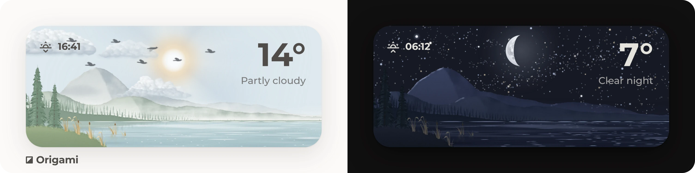
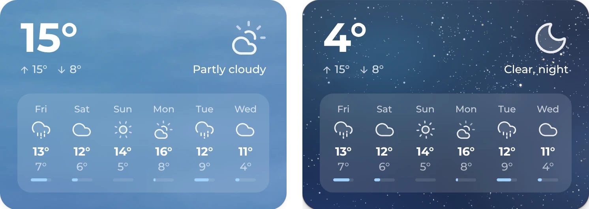

# ◪ Origami Weather

<div>
<a href="https://github.com/hazymorning/origami_weather/releases/latest"></a>
<a href="https://my.home-assistant.io/redirect/hacs_repository/?owner=hazymorning&repository=origami_weather&category=plugin"></a>
<a href="https://github.com/hazymorning?tab=repositories&q=origami"></a>
</div>

<br>



Origami Weather is a weather card for Home Assistant that can become almost any weather card. Everything on it is built from simple parts that can be combined freely, so a classic forecast is just as possible as something completely different. The layouts are ready to use and a good place to start.

[Get started](#get-started) · [Layouts](#layouts) · [More](#more)

## Get started

<details>
<summary><b>Install the card</b></summary>

<br>

Origami Weather is in the HACS default store.

1. Open Origami Weather in HACS and select **Download**.

   [](https://my.home-assistant.io/redirect/hacs_repository/?owner=hazymorning&repository=origami_weather&category=plugin)

2. Reload the page.

Without HACS, copy every file in `dist` from the [latest release](https://github.com/hazymorning/origami_weather/releases/latest) to a folder of its own, such as `/config/www/origami-weather`, add `/local/origami-weather/origami-weather.js` as a **JavaScript module** under [Resources](https://my.home-assistant.io/redirect/lovelace_resources/) and reload the page with a hard refresh. The card loads the other files from the same folder when it needs them.

</details>

<details>
<summary><b>Add the card</b></summary>

<br>

1. Edit a dashboard and add the **Origami Weather** card.
2. Choose the weather entity and a layout.
3. Change anything in the visual editor or in the code editor.

> **Choose the layout first.** A layout chosen in the visual editor replaces all of the card's settings, so the changes come after it.

</details>

## Layouts

<sub>The screenshots use the Montserrat font. The [Origami](https://github.com/hazymorning/origami#get-started) repository explains how to add it to Home Assistant.</sub>

### Diorama


A little paper landscape for each kind of weather, made for the [Origami](https://github.com/hazymorning/origami) dashboard. The sun and the moon cross the sky and set behind the hills, and a frosted bar in the top left corner slides through today's high and low, the wind, the next sunset or sunrise, the humidity and the UV index.

<details>
<summary><b>Load the pictures from Home Assistant</b></summary>

<br>

The diorama loads its pictures from Origami's repository through jsDelivr. To load them from Home Assistant instead:

1. Copy the folder [`diorama`](https://github.com/hazymorning/origami/tree/main/dashboard/weather/diorama) from Origami to `/config/www`, so the pictures are in `/config/www/diorama/light` and `/config/www/diorama/dark`.
2. Set the two picture folders in the card to `/local/diorama/light/` and `/local/diorama/dark/`, under **Background** in the visual editor or as `weather_image_path` and `weather_image_path_dark` in the code editor.

</details>

### Classic



The temperature and the current weather on a color that changes with it, today's high and low, and a forecast that slides through the coming days, with the chance of rain under each day. When it's cloudy, layers of soft mist drift across the card at different speeds, and in fog they close in.

### Centered


The temperature and the current weather in the middle, with the day's high and low and the wind. The clouds drift through soft layers of mist, which fill the sky in fog.

### Home


A house in its garden that follows the sun, with the temperature of each room and a compass for the wind.

<details>
<summary><b>The house in detail</b></summary>

<br>

The card draws the house itself. The sun lights the walls, the tree and the shrubs from where it really is, and their shadows follow it across the lawn. When it snows, the roofs, the tree and the lawn turn white and smoke rises from the chimney, and in dark mode the windows light up and throw their light onto the lawn. The rooms show the weather entity's temperature until each one is set to a room sensor.

The plain house of earlier versions is still there: `image: old-home` on the container brings it back.

</details>

<details>
<summary><b>Draw a real home with AI</b></summary>

<br>

An AI can draw a real home and build the card around it, in any style and with as much around the house as fits, from a bit of lawn to the whole garden or the hills behind it. Use the most capable model available. It has to understand photos, draw clean pictures and read the card's source code, which comes to about 300 KB of text together with the README and the reference. A model that can run code does better, because it can look at its pictures before handing them over.

A drawn home is a normal picture file, and the card can't change anything inside it. So everything that should change, like the night, a room's light, the sunlight or snow, becomes a picture of its own that lies exactly on top of the house. The card shows or fades these pictures as needed. A day and a night picture are enough to start with.

1. Download [`README.md`](README.md), [`REFERENCE.md`](REFERENCE.md) and the card itself, [`src/origami-weather.js`](src/origami-weather.js), from this repository.
2. Take photos of the home from the front, the back and two corners, and of anything around it that should be in the picture.
3. Find out which way the front of the house faces, on a map for example.
4. Look up the entity IDs of the room sensors and of the lights that should light up windows, under **Settings → Devices & services → Entities**.
5. Copy the YAML of a card with the Home layout from the code editor.
6. Give it all to the AI with this text and fill in the brackets. They hold examples, so a pixel art style, the hills behind the house or a picture across the whole card work just as well.

```text
I'm using the Origami Weather card for Home Assistant and want my own home in its Home layout. Attached are the card's README and REFERENCE, its source code (origami-weather.js), my card YAML and photos of my home.

Draw my home as it really is, in a [watercolor] style, with [our garden with the apple tree and the hedge] around it. Put it [where the layout's picture is], in front of [the card's own sky with the sun, the moon, clouds and stars]. The front of the house faces [south-west]. The rooms are [the living room with sensor.living_room_temperature and the two big windows on the garden side] and [...]. [light.living_room] should light up the windows of [the living room], and [...]. Besides day and night, the picture should change with [the lights, the sun and snow].

Read everything before you start. Work out from origami-weather.js how containers show image and image_dark, how free-positioned containers stack, and how visibility and the css option work. For css, the card sets the classes scheme-light or scheme-dark and weather-<condition> on #card-root. It also sets --origami-sun-x and --origami-sun-y for the direction of the sun (x is 1 in the east and -1 in the west, y is 1 in the north and -1 in the south), --origami-sun-light for the strength of the sunlight from 0 to 1, and --origami-sun-shadow for the length of a shadow compared to the height of what casts it.

My pictures are image files, so the card can't change anything inside them. Every change needs a picture of its own, in its own container with exactly the same position and width as the house, stacked in the right order. Draw all pictures on the same canvas so they line up, and let an overlay hold only what changes and only what can be seen. SVG makes this easiest. If the style needs painted pictures, use PNG or WebP with transparency and keep the framing exactly the same.

Show lit windows and the light they throw outside while their light is on, and snow while the weather is snowy or snowy-rainy. Fade and move the sunlight and the shadows with the sun through the css option, with fallbacks for missing values, and pick each picture by its file name, like img.group-image[src*="sun-east"]. Keep the house recognizable, but simple enough to read at the size it gets in the card, and leave the background transparent where the card should show through. Use my sensors for the rooms. If the temperatures sit on the picture, place them as free-positioned buttons with offsets in %.

Show me your plan and my home in daylight first, and wait for my OK before you make the rest. If you can run code, check every picture in light and dark mode, in the morning, at noon and in the evening, and with each light on and off. Then give me the files, where they go (/config/www/home/, used as /local/home/...) and the complete card YAML.
```

The pictures go into `/config/www/home`, for example with the File editor or a Samba share. If the `www` folder is new, Home Assistant needs one restart before it serves it. After pasting the YAML into the card's code editor, a hard refresh shows the new pictures. Browsers keep pictures for a while, so a changed picture needs one too.

It rarely comes out right on the first try. Screenshots of the card and one or two concrete wishes at a time work best, like a flatter roof or a taller tree. Error messages can go to the AI as they are.

Once it works, play around with the settings to find a look that fits. The Home layout turns off the sun, the moon, the clouds, the stars, the birds, the balloons and the planes, and only rain and snow still fall. Turning some of them back on or trying another background can change the whole feel, and almost anything in the README and the reference can go into it, so let the AI try things.

</details>

### Other layouts

Slim, Comparison and Arc are no longer in the layout picker, but they still work. Paste one into the code editor and change each `weather.home` in it to the home's weather entity.

<details>
<summary><b>Slim</b></summary>

<br>


The current weather with a row of small chips for today's high, the wind, the next sunset or sunrise, the humidity and the UV index.

```yaml
type: custom:origami-weather
weather_entity: weather.home
sun_moon_x: dynamic
card_height: content
card_padding: 16px
content_align: between
content_align_items: start
button_containers:
- buttons:
  - entity: weather.home
    elements:
    - type: icon
      icon: weather
      icon_background: false
      margin: 0 2px 0 0
    - type: text
      precision: 0
      entity: weather.home
      attribute: temperature
      weight: '700'
      fancy_unit: true
    style: inline
  padding: 4px
  button_text_size: 26px
  margin: 0 0 32px 0
  button_gap: 6px
  button_style: vertical
- background: true
  gap: 8px
  button_gap: 6px
  button_icon_size: 14px
  button_padding: 8px 12px 8px 10px
  align: center
  button_text_size: 12px
  background_color: rgba(255,255,255,0.1)
  blurred_background: true
  buttons:
  - entity: weather.home
    elements:
    - type: text
      text: Today
      weight: '500'
    - type: icon
      icon: weather
    - type: text
      format: °
      weight: '700'
      attribute: temperature
    style: inline
    forecast: daily
  - entity: weather.home
    elements:
    - type: icon
      icon: mdi:weather-windy
    - type: text
      attribute: wind_speed
      format: ' km/h'
      weight: '700'
    style: inline
  - entity: sun.sun
    elements:
    - type: icon
      icon: mdi:weather-sunset-up
    - type: text
      attribute: next_rising
      weight: '700'
    visibility:
    - condition: state
      entity: sun.sun
      state: below_horizon
  - entity: sun.sun
    elements:
    - type: icon
      icon: mdi:weather-sunset-down
    - type: text
      attribute: next_setting
      weight: '700'
    visibility:
    - condition: state
      entity: sun.sun
      state: above_horizon
  - entity: weather.home
    elements:
    - type: icon
      icon: mdi:water-percent
    - type: text
      weight: '700'
      attribute: humidity
      format: ' %'
    style: inline
  - entity: weather.home
    elements:
    - type: icon
      icon: mdi:sun-wireless-outline
    - type: text
      text: UV-Index
      weight: '500'
    - type: text
      attribute: uv_index
      weight: '700'
    forecast: daily
  button_background_color: rgba(189,189,189,0.2)
  layout: horizontal-scroll
  scroll_fade: true
grid_options:
  rows: auto
  columns: 12
```

</details>

<details>
<summary><b>Comparison</b></summary>

<br>


The temperature outside beside tiles for today and the next days, with a bar that compares it with today's high, and today's chance of rain.

```yaml
type: custom:origami-weather
weather_entity: weather.home
sun_enabled: false
moon_enabled: false
sun_moon_x: dynamic
card_height: content
card_padding: 20px
card_offset: 8px 0px 0px 0px
color_mode: theme
background_mode: color
background_threshold_entity: weather.home
background_thresholds:
- value: sunny
  color: color-mix(in srgb, var(--ha-card-background, var(--card-background-color)) 80%, rgb(245,185,70))
- value: clear-night
  color: color-mix(in srgb, var(--ha-card-background, var(--card-background-color)) 80%, rgb(80,90,180))
- value: partlycloudy
  color: color-mix(in srgb, var(--ha-card-background, var(--card-background-color)) 82%, rgb(120,175,225))
- value: cloudy
  color: color-mix(in srgb, var(--ha-card-background, var(--card-background-color)) 84%, rgb(145,155,175))
- value: fog
  color: color-mix(in srgb, var(--ha-card-background, var(--card-background-color)) 84%, rgb(185,185,200))
- value: windy
  color: color-mix(in srgb, var(--ha-card-background, var(--card-background-color)) 84%, rgb(90,190,175))
- value: windy-variant
  color: color-mix(in srgb, var(--ha-card-background, var(--card-background-color)) 84%, rgb(110,170,200))
- value: rainy
  color: color-mix(in srgb, var(--ha-card-background, var(--card-background-color)) 80%, rgb(70,130,200))
- value: pouring
  color: color-mix(in srgb, var(--ha-card-background, var(--card-background-color)) 76%, rgb(45,95,190))
- value: lightning
  color: color-mix(in srgb, var(--ha-card-background, var(--card-background-color)) 80%, rgb(150,105,220))
- value: lightning-rainy
  color: color-mix(in srgb, var(--ha-card-background, var(--card-background-color)) 76%, rgb(115,85,205))
- value: hail
  color: color-mix(in srgb, var(--ha-card-background, var(--card-background-color)) 80%, rgb(100,185,210))
- value: snowy
  color: color-mix(in srgb, var(--ha-card-background, var(--card-background-color)) 80%, rgb(180,215,245))
- value: snowy-rainy
  color: color-mix(in srgb, var(--ha-card-background, var(--card-background-color)) 80%, rgb(135,175,215))
- value: exceptional
  color: color-mix(in srgb, var(--ha-card-background, var(--card-background-color)) 76%, rgb(230,95,65))
background_haze: false
precipitation_effects: false
cloud_effects: false
night_sky_effects: false
button_containers:
- buttons:
  - entity: weather.home
    background: false
    padding: '0'
    style: vertical
    align: start
    inner_gap: 6px
    elements:
    - type: text
      text: Outside
      size: 14px
      weight: '500'
    - type: text
      attribute: temperature
      precision: 0
      format: °
      size: 42px
      weight: '800'
- position: custom
  position_anchor: top-right
  layout: horizontal-scroll
  custom_width: 60%
  scroll_count: 3
  gap: 8px
  background: true
  button_style: vertical
  button_padding: 16px 12px
  button_icon_size: 26px
  button_icon_padding: 0 0 8px 0
  button_shadow: false
  button_blurred_background: true
  buttons:
  - entity: weather.home
    forecast: daily
    align: center
    background_color: rgba(150,150,150,0.14)
    elements:
    - type: icon
      icon: weather
    - type: text
      size: 12px
      weight: '500'
      attribute: datetime
    - type: text
      weight: '700'
      attribute: temperature
      format: °
  - entity: weather.home
    forecast: daily
    forecast_offset: 1
    align: center
    background_color: rgba(150,150,150,0.12)
    elements:
    - type: icon
      icon: weather
    - type: text
      size: 12px
      weight: '500'
      attribute: datetime
    - type: text
      weight: '700'
      attribute: temperature
      format: °
  - entity: weather.home
    forecast: daily
    forecast_offset: 2
    align: center
    background_color: rgba(150,150,150,0.1)
    elements:
    - type: icon
      icon: weather
    - type: text
      size: 12px
      weight: '500'
      attribute: datetime
    - type: text
      weight: '700'
      attribute: temperature
      format: °
  - entity: weather.home
    forecast: daily
    forecast_offset: 3
    align: center
    background_color: rgba(150,150,150,0.08)
    elements:
    - type: icon
      icon: weather
    - type: text
      size: 12px
      weight: '500'
      attribute: datetime
    - type: text
      weight: '700'
      attribute: temperature
      format: °
- padding: '0'
  margin: 66px 0 8px 0
  buttons:
  - entity: weather.home
    forecast: daily
    background: false
    padding: '0'
    width: 100%
    elements:
    - type: bar
      bar_min: '-10'
      bar_max: '35'
      bar_height: 2px
      bar_color: rgba(150,150,150,0.6)
      bar_marker_size: 10px
      bar_values:
      - entity: weather.home
        attribute: temperature
        marker_color: '#ffffff'
      - attribute: temperature
- padding: 0 4px
  margin: 12px 0 0 0
  align: start
  button_text_size: 16px
  buttons:
  - entity: weather.home
    background: false
    padding: '0'
    align: spread
    elements:
    - type: icon
      icon: weather
      padding: 0 4px 0 0
    - type: text
      weight: '700'
      margin: 0 auto 0 0
  - entity: weather.home
    forecast: daily
    background: false
    padding: '0'
    align: spread
    elements:
    - type: icon
      icon: mdi:umbrella-outline
      margin: 0 0 0 auto
    - type: text
      attribute: precipitation_probability
      format: ' %'
      weight: '400'
grid_options:
  rows: auto
  columns: 12
```

</details>

<details>
<summary><b>Arc</b></summary>

<br>

The sun on an arc from sunrise to sunset and the moon on one from sunset to sunrise, with the temperature and the next sunset or sunrise below it. The arcs read `sensor.sun_next_rising` and `sensor.sun_next_setting` from the Sun integration, and the sun or moon on them follows `sensor.time` from the Time & Date integration.

```yaml
type: custom:origami-weather
weather_entity: weather.home
sun_moon_size: 100
sun_moon_y: 44
card_height: auto
card_padding: '0'
bird_effects: false
balloon_effects: false
plane_effects: false
button_containers:
- position: custom
  position_anchor: top
  position_y: 10cqh
  buttons:
  - entity: sun.sun
    elements:
    - type: text
      text: ' '
    visibility:
    - condition: state
      entity: sun.sun
      state: above_horizon
    type: ring
    width: 68cqmin
    background: false
    ring_min: sensor.sun_next_rising
    ring_max: sensor.sun_next_setting
    ring_start: 240
    ring_arc: 240
    ring_width: '4'
    ring_color: color-mix(in srgb, currentColor 40%, transparent)
    ring_values:
    - entity: sensor.time
      marker_size: 0
    - entity: sensor.sun_next_rising
      marker_size: '26'
      marker_color: rgba(0,0,0,0.8)
      marker_icon: mdi:weather-sunset-up
      marker_icon_color: '#ffffff'
    - entity: sensor.sun_next_setting
      marker_size: '26'
      marker_color: rgba(0,0,0,0.8)
      marker_icon: mdi:weather-sunset-down
      marker_icon_color: '#ffffff'
    - entity: sensor.time
      marker_size: '40'
      marker_color: '#ffffff'
      marker_icon: mdi:white-balance-sunny
      marker_icon_color: '#2c2c2e'
  - entity: sun.sun
    elements:
    - type: text
      text: ' '
    visibility:
    - condition: state
      entity: sun.sun
      state: below_horizon
    type: ring
    width: 68cqmin
    background: false
    ring_min: sensor.sun_next_setting
    ring_max: sensor.sun_next_rising
    ring_start: 240
    ring_arc: 240
    ring_width: '4'
    ring_color: color-mix(in srgb, currentColor 40%, transparent)
    ring_values:
    - entity: sensor.time
      marker_size: 0
    - entity: sensor.sun_next_setting
      marker_size: '26'
      marker_color: rgba(0,0,0,0.8)
      marker_icon: mdi:weather-sunset-down
      marker_icon_color: '#ffffff'
    - entity: sensor.sun_next_rising
      marker_size: '26'
      marker_color: rgba(0,0,0,0.8)
      marker_icon: mdi:weather-sunset-up
      marker_icon_color: '#ffffff'
    - entity: sensor.time
      marker_size: '40'
      marker_color: '#ffffff'
      marker_icon: mdi:weather-night
      marker_icon_color: '#2c2c2e'
- position: custom
  position_anchor: bottom-left
  position_x: 7cqw
  position_y: 7cqh
  padding: '0'
  button_style: vertical
  button_padding: '0'
  button_gap: 8px
  buttons:
  - entity: weather.home
    background: false
    elements:
    - type: text
      attribute: temperature
      precision: 0
      format: °
      size: clamp(24px, 8cqmin, 36px)
      weight: '700'
    - type: text
      size: clamp(13px, 3.5cqmin, 16px)
      weight: '500'
- position: custom
  position_anchor: bottom-right
  position_x: 7cqw
  position_y: 7cqh
  align: end
  padding: '0'
  button_style: vertical
  button_padding: '0'
  button_gap: 8px
  buttons:
  - entity: sun.sun
    elements:
    - type: text
      attribute: next_setting
      size: clamp(24px, 8cqmin, 36px)
      weight: '700'
    - type: text
      text: Sunset
      size: clamp(13px, 3.5cqmin, 16px)
      weight: '500'
    visibility:
    - condition: state
      entity: sun.sun
      state: above_horizon
    background: false
  - entity: sun.sun
    elements:
    - type: text
      attribute: next_rising
      size: clamp(24px, 8cqmin, 36px)
      weight: '700'
    - type: text
      text: Sunrise
      size: clamp(13px, 3.5cqmin, 16px)
      weight: '500'
    visibility:
    - condition: state
      entity: sun.sun
      state: below_horizon
    background: false
grid_options:
  columns: 12
  rows: 6
```

</details>

## More

<a name="backgrounds"></a>
<details>
<summary><b>The sky and its effects</b></summary>

<br>

The card shows an animated sky behind the content that follows the weather and the sun. Its color shifts from day to night, the sun rises and sets, stars come out at night with the occasional shooting star, birds cross the sky, balloons drift past and planes pass overhead. Clouds, mist, rain and snow add to it.

The sky and each kind of effect can be turned off, rain and snow with one switch. The effects also work on top of the other backgrounds, which `background_mode` sets: a picture for each kind of weather, a color, the plain card background or none. The card also works in Home Assistant's plain style, with just the content and nothing else going on.

With `background_mode: none` and `card_frame: false`, the card loses its own styling and blends in with the dashboard, and `full_width: true` stretches it over the full width. This mostly works in specific places, such as a dashboard header. The [reference](REFERENCE.md#background) lists every option.

</details>

<details>
<summary><b>Building blocks</b></summary>

<br>

Every layout is built from the same blocks. Containers hold buttons, and each button shows an entity with text, icons, bars or a ring. A container can also hold a picture, such as a floor plan with each room's temperature on it, or other Home Assistant cards.

Containers and buttons can also have a name. The card doesn't show it, but the visual editor lists them by it, so the parts of a bigger layout are easy to tell apart.

The [reference](REFERENCE.md) explains each block and every option. For a new layout, the YAML of a finished one in the code editor is a good start.

</details>

<details>
<summary><b>Performance</b></summary>

<br>

An animated weather card has to run on all kinds of setups, so a lot of care went into keeping this one light. That's why there are no extra performance options. It already runs at the lowest level that still lets it do what it's meant to do. Pictures like the clouds, the birds and the house only load once a card shows them, and the editor only when a card is edited.

If it still feels too heavy on a device, most features can be turned off one by one. Plain weather pictures, or leaving out the decorative parts entirely, make it even lighter.

</details>

<sub>Origami Weather continues a hobby project from early 2026, first called Atmospheric Weather Card on an earlier GitHub account. AI is used as a tool in this project.</sub>
