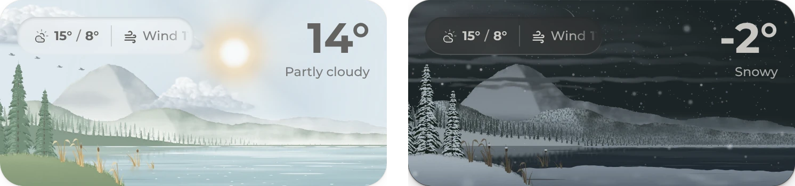
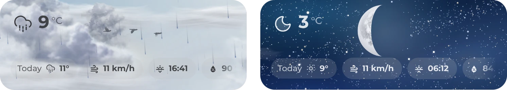
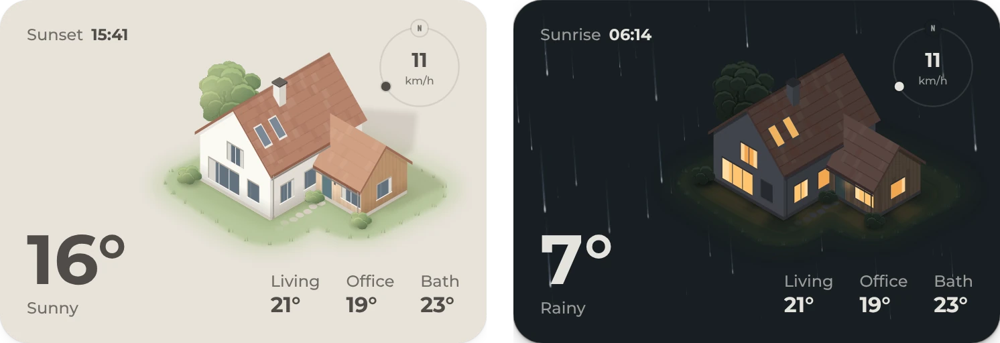
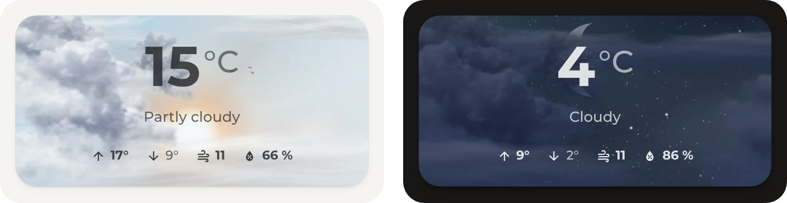
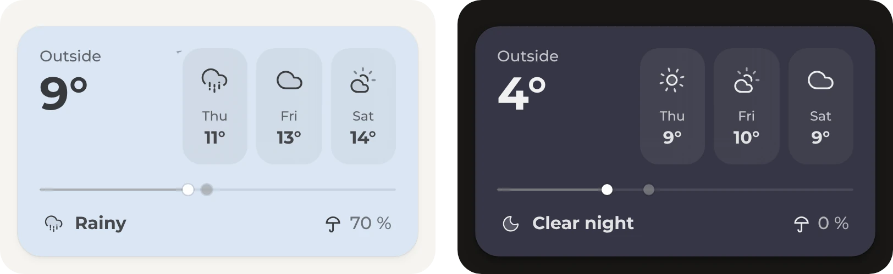

# ◪ Origami Weather

<div>
<a href="https://github.com/hazymorning/origami_weather/releases/latest"></a>
<a href="https://my.home-assistant.io/redirect/hacs_repository/?owner=hazymorning&repository=origami_weather&category=plugin"></a>
<a href="https://github.com/hazymorning?tab=repositories&q=origami"></a>
</div>

Origami Weather is a weather card for Home Assistant with finished layouts and a builder approach. It works as it is or changes as much as wanted, and it should cover most uses.

[Get started](#get-started) · [Layouts](#layouts) · [More](#more)

## Get started

<details>
<summary><b>Install the card</b></summary>

<br>

Origami Weather is in the HACS default store.

1. Open Origami Weather in HACS and select **Download**.

   [](https://my.home-assistant.io/redirect/hacs_repository/?owner=hazymorning&repository=origami_weather&category=plugin)

2. Reload the page.

Without HACS, copy [`dist/origami-weather.js`](https://github.com/hazymorning/origami_weather/blob/main/dist/origami-weather.js) to `/config/www` and add `/local/origami-weather.js` as a **JavaScript module** under [Resources](https://my.home-assistant.io/redirect/lovelace_resources/).

</details>

<details>
<summary><b>Add the card</b></summary>

<br>

1. Edit a dashboard and add the **Origami Weather** card.
2. Choose the weather entity and a layout. For the diorama, paste its file into the code editor instead.
3. Change what's needed in the visual editor, or in the code editor.

> **Layout first.** Choosing another layout replaces the card's content, so the layout comes first and the changes after.

</details>

## Layouts

Each layout is a starting point, and every piece of it can change.

### Diorama



A little paper landscape for each kind of weather, made for the [Origami](https://github.com/hazymorning/origami) dashboard. [`diorama.yaml`](https://github.com/hazymorning/origami/blob/main/dashboard/weather/diorama.yaml)

<details>
<summary><b>Keep the pictures in Home Assistant</b></summary>

<br>

The file loads its pictures from Origami's repository, so it works right away. Kept in Home Assistant, they load without the internet.

1. Download Origami with **Code** and **Download ZIP** on [its page](https://github.com/hazymorning/origami), and copy the folder `dashboard/weather/diorama` to `/config/www/diorama`.
2. In the card's code editor, set `weather_image_path` to `/local/diorama/light/` and `weather_image_path_dark` to `/local/diorama/dark/`.

</details>

### Slim



The weather now and a row of small chips, made for the top of a page.

### Home



A house that casts its shadow with the sun and lights its windows at night, with the temperature of each room.

<details>
<summary><b>The house in detail</b></summary>

<br>

The card draws the house. Its shadow follows the sun, the ring around it shows the sun's path for the day, the wet ground mirrors it in the rain and the roof turns white in the snow. The rooms show the weather entity's temperature until they point to sensors of their own.

</details>

<details>
<summary><b>The home's own house</b></summary>

<br>

An AI can draw a home in the same style and build the layout around it. It takes a capable model that understands photos and draws clean SVGs.

1. Download `README.md` and `REFERENCE.md` from this repository, and `src/image-assets.js`, whose last entry, `DEMO_HOME`, is the demo house.
2. Take a few photos of the home, ideally one from the front and one from a corner.
3. Copy the YAML of a card with the Home layout from the code editor.
4. Give it all to the AI with this text, with the brackets filled in. Lights are optional, for rooms that light up.

```text
I'm using the Origami Weather card for Home Assistant and want to turn its Home layout into my own home. Attached are the card's README and REFERENCE (every option), my card YAML with the Home layout, image-assets.js (DEMO_HOME at the end is the demo house) and photos of my home.

1. Draw my home as an SVG in the style of DEMO_HOME: isometric, flat matte colors, no outlines, soft ground shadow, transparent background, square viewBox with the house centered. Recognizable, but simplified.
2. Make two versions, one for light mode and one for dark mode, for `image` and `image_dark` on the container. Both are loaded as normal image files, so they can't read the card's CSS variables or classes the way DEMO_HOME does.
3. Rebuild the card YAML around it. Put each room's temperature on that room as free-positioned buttons inside the image container, with offsets in %, so they stay in place when the card resizes. Use my sensors instead of the weather entity:
   [sensor.living_room_temperature: living room]
   [...]
4. Optional: make a room light up when its light is on, for example with a lit window overlay as an icon element (`icon_path`) that only shows through `visibility`. Keep the windows dark in both base images then.
   [light.living_room: living room]
   [...]

Read the whole README and REFERENCE before you start and really use what's in them: containers, free positioning, all element types, visibility, thresholds, the gradient layer and the `css` option. For `css`, the card sets --origami-sun-x, --origami-sun-y, --origami-sun-shadow and --origami-sun-light, and #card-root has scheme-light/scheme-dark and weather-<condition> classes.

Give me the SVG files, where they go (/config/www/, used as /local/...) and the complete card YAML.
```

The SVG files go into the `www` folder of Home Assistant's configuration. The Home layout turns off the sun, the clouds and the other effects, and turning some of them back on, or another background, changes the whole feel.

</details>

### Centered



The temperature in the middle, with the day's high and low, wind and humidity.

### Comparison



The temperature now against the next days, on a bar, with the chance of rain.

## More

<a name="backgrounds"></a>
<details>
<summary><b>The sky and its effects</b></summary>

<br>

The sky behind the content changes from day to night, the sun rises and sets, and stars come out at night with a shooting star now and then. Clouds, rain and snow, birds, balloons and planes cross it, each with an option of its own.

`background_mode` picks the sky, pictures for each kind of weather, a color, the plain card background or none at all. With `background_mode: none` and `card_frame: false`, the card blends into the dashboard, and `full_width: true` stretches it across the page, such as for a header. The [reference](REFERENCE.md#background) lists every option.

</details>

<details>
<summary><b>A card of its own</b></summary>

<br>

Each layout is made of containers, which hold buttons, and each button shows its entity with text, icons and bars, or a ring around it. A container can also hold a picture, such as a floor plan with each room's temperature on it, or other Home Assistant cards. The [reference](REFERENCE.md) explains each building block and every option, and the code editor shows the YAML of any layout as a starting point.

</details>

<details>
<summary><b>Speed</b></summary>

<br>

The card is made to run on any device, so it has no extra settings for speed. Where it still feels heavy, each effect turns off on its own, and pictures or a plain color are lighter than the animated sky.

</details>

<sub>Origami Weather continues a hobby project from early 2026, first called Atmospheric Weather Card on an earlier GitHub account. AI is used as a tool in this project.</sub>
