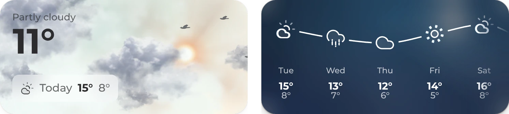

# ◪ Origami Weather

<div>
<a href="https://github.com/hazymorning/origami_weather/releases/latest"></a>
<a href="https://my.home-assistant.io/redirect/marketplace_repository/?owner=hazymorning&repository=origami_weather"></a>
<a href="https://github.com/hazymorning?tab=repositories&q=origami"></a>
</div>

<br>


Origami Weather is a weather card for Home Assistant with a builder approach. It can be a visual, animated weather card, a classic info-rich one, or something completely different. It comes with several ready-made layouts, but every part can be changed or mixed and matched freely.

Behind the content is an animated sky that follows the actual weather. The sun and the moon move with the time of day, clouds and mist drift with the wind, and it rains or snows on the card when it does outside. The content itself is built from containers, buttons, texts, icons and bars, and they can show any entity in Home Assistant, not just the weather.

[](https://my.home-assistant.io/redirect/marketplace_repository/?owner=hazymorning&repository=origami_weather)

[Get started](#get-started) · [Layouts](#layouts) · [Reference](REFERENCE.md) · [More](#more)

## Get started

1. Install Origami Weather from the Marketplace with the button above, then reload the page. On Home Assistant versions before 2026.11, it's in [HACS](https://my.home-assistant.io/redirect/hacs_repository/?owner=hazymorning&repository=origami_weather&category=plugin) instead.
2. Edit a dashboard, add the **Origami Weather** card, and pick the weather entity and a layout.
3. Change anything in the visual editor or the code editor.

> **Pick the layout first.** Choosing a layout replaces all of the card's settings, so customize the card after that.

<a name="manual-install"></a>
<details>
<summary><b>Install without the Marketplace</b></summary>

<br>

Copy everything in `dist` from the [latest release](https://github.com/hazymorning/origami_weather/releases/latest), including the `diorama` folder, into a folder such as `/config/www/origami-weather`. Then add `/local/origami-weather/origami-weather.js` as a **JavaScript module** under [Resources](https://my.home-assistant.io/redirect/lovelace_resources/) and reload the page with a hard refresh. The card loads its other files and pictures from the same folder when it needs them.

</details>

## Layouts

### Diorama


A little paper landscape that changes with the weather and the time of day. It was made for the [Origami](https://github.com/hazymorning/origami) dashboard and only shows the current weather. Tapping the card opens Home Assistant's weather dialog with the full forecast.

### Classic


A familiar weather card with a large weather icon next to the temperature, today's high, low and humidity, and the next days in a row that scrolls sideways. The background takes on a rich color for each kind of weather and gets darker at night. Most effects are off for a calmer look, but each one can be turned back on.

### Sky



The animated sky fills the whole card, with the temperature, the condition and today's high in the middle of it. Birds, rain and snow pass in front of the text. A tap on the card shows the next days, and another tap goes back.

### Home


A drawn house with the temperature outside and in each room, and the wind on a compass. Sunlight hits the house from the sun's actual direction, the roofs turn white when it snows, and the windows light up at night. An AI can also [draw a real home](#house) in its place.

### Panel


A detailed overview for a larger spot on the dashboard. The condition and today's high and low are on the left, with a large temperature on the right. Six tiles show the wind, humidity, UV index, chance of rain, air pressure and the time of the last update, with the next hours below. It uses the theme's card background, so it fits right in with other cards.

<sub>The screenshots use the Montserrat font. The [Origami](https://github.com/hazymorning/origami#get-started) README explains how to add it to Home Assistant.</sub>

## More

<a name="backgrounds"></a>
<a name="pictures"></a>
<details>
<summary><b>Backgrounds and effects</b></summary>

<br>

The animated sky follows the weather and the time of day. Its colors shift from day to night, the sun and the moon rise and set, and clear nights get stars and the occasional shooting star. Clouds, mist, rain and snow appear when the weather calls for them, the clouds and the mist drift with the wind, and the rain slants with it. Now and then, birds, a balloon or a plane cross the sky.

Every effect can be turned off on its own, and rain and snow share one switch. The effects also work on the other backgrounds that `background_mode` offers: a picture for each kind of weather, a single color, the theme's card background, or none at all. With everything off, the card looks like any other Home Assistant card.

With `background_mode: none` and `card_frame: false`, the card drops its frame and blends into the dashboard, and `full_width: true` stretches it across the whole width. That's mostly useful in special spots like a dashboard header. The [reference](REFERENCE.md#background) lists every option.

#### Pictures for each kind of weather

The Diorama's pictures come with the card, so Home Assistant serves them itself and nothing loads from the internet. Any layout can show its own picture for each kind of weather, and the Diorama can use other pictures too.

1. Name the pictures after the weather conditions, like the Diorama's pictures in [`dist/diorama`](https://github.com/hazymorning/origami_weather/tree/main/dist/diorama): `sunny.webp`, `partlycloudy.webp`, `clear-night.webp` and so on.
2. Copy them into a folder in `/config/www`, such as `/config/www/weather`. Pictures for dark mode go into a second folder.
3. Under **Background**, set the background to **Custom images**, the light mode folder to `/local/weather/`, and the dark mode folder to the second folder, or leave it empty if there isn't one. In YAML, these are `background_mode: images`, `weather_image_path` and `weather_image_path_dark`.

For a Diorama card, also set the **File type** to the type of the pictures or to **Automatic**, and turn off **In front of the sun, the moon and the stars** unless the pictures have a transparent sky.

Updates replace everything in the card's own folder, so keep other pictures in a folder outside of it.

</details>

<a name="house"></a>
<details>
<summary><b>The house in the Home layout</b></summary>

<br>

The card draws the house itself, so the house can react to what's going on around it. Sunlight comes from where the sun really is and the shadows move across the lawn during the day, the roofs and the lawn turn white while it snows, and the windows light up in dark mode. Each room shows the outside temperature until it gets a sensor of its own.

The house from earlier versions is still there: `image: old-home` on its container brings it back.

#### Draw a real home with AI

An AI can draw a real home and build the card around it, in any style and with as much of the surroundings as fits, from a strip of lawn to the whole garden or the hills behind it. Use the most capable model available. It has to understand photos, draw clean pictures and read the card's source code, which together with the README and the reference is well over 300 KB of text. A model that can run code does better, because it can check its pictures before handing them over.

A drawn home is a plain picture file, and the card can't change anything inside it. So everything that should change, like the night, a lit room, the sunlight or snow, becomes a separate picture that sits exactly on top of the house, and the card shows or fades these pictures as needed. A day picture and a night picture are enough to start with.

1. Download [`README.md`](README.md), [`REFERENCE.md`](REFERENCE.md) and the card itself, [`src/origami-weather.js`](src/origami-weather.js), from this repository.
2. Take photos of the home from the front, the back and two corners, and of anything around it that should be in the picture.
3. Find out which way the front of the house faces, for example on a map.
4. Look up the entity IDs of the room sensors and of the lights that should light up windows, under **Settings → Devices & services → Entities**.
5. Copy the YAML of a card with the Home layout from the code editor.
6. Give it all to the AI with this text, and fill in the brackets. They hold examples, so a pixel art style, the hills behind the house or a picture across the whole card work just as well.

```text
I'm using the Origami Weather card for Home Assistant and want my own home in its Home layout. Attached are the card's README and REFERENCE, its source code (origami-weather.js), my card YAML and photos of my home.

Draw my home as it really is, in a [watercolor] style, with [our garden with the apple tree and the hedge] around it. Put it [where the layout's picture is], in front of [the card's own sky with the sun, the moon, clouds and stars]. The front of the house faces [south-west]. The rooms are [the living room with sensor.living_room_temperature and the two big windows on the garden side] and [...]. [light.living_room] should light up the windows of [the living room], and [...]. Besides day and night, the picture should change with [the lights, the sun and snow].

Read everything before you start. Work out from origami-weather.js how containers show image and image_dark, how free-positioned containers stack, and how visibility and the css option work. For css, the card sets the classes scheme-light or scheme-dark and weather-<condition> on #card-root. It also sets --origami-sun-x and --origami-sun-y for the direction of the sun (x is 1 in the east and -1 in the west, y is 1 in the north and -1 in the south), --origami-sun-light for the strength of the sunlight from 0 to 1, and --origami-sun-shadow for the length of a shadow compared to the height of what casts it.

My pictures are image files, so the card can't change anything inside them. Every change needs a picture of its own, in its own container with exactly the same position and width as the house, stacked in the right order. Draw all pictures on the same canvas so they line up, and let an overlay hold only what changes and only what can be seen. SVG makes this easiest. If the style needs painted pictures, use PNG or WebP with transparency and keep the framing exactly the same.

Show lit windows and the light they throw outside while their light is on, and snow while the weather is snowy or snowy-rainy. Fade and move the sunlight and the shadows with the sun through the css option, with fallbacks for missing values, and pick each picture by its file name, like img.group-image[src*="sun-east"]. Keep the house recognizable, but simple enough to read at the size it gets in the card, and leave the background transparent where the card should show through. Use my sensors for the rooms. If the temperatures sit on the picture, place them as free-positioned buttons with offsets in %.

Show me your plan and my home in daylight first, and wait for my OK before you make the rest. If you can run code, check every picture in light and dark mode, in the morning, at noon and in the evening, and with each light on and off. Then give me the files, where they go (/config/www/home/, used as /local/home/...) and the complete card YAML.
```

The pictures go into `/config/www/home`, for example with the File editor add-on or a Samba share. If the `www` folder is new, restart Home Assistant once so it starts serving it. After pasting the YAML into the card's code editor, a hard refresh shows the new pictures. Browsers cache pictures for a while, so a changed picture needs a hard refresh too.

It rarely works on the first try. Screenshots of the card with one or two specific requests at a time work best, like a flatter roof or a taller tree, and error messages can go to the AI as they are.

Once it works, it's worth playing with the settings. The Home layout turns off the sun, moon, clouds, stars, balloons and planes, which leaves birds, rain, snow and a light mist. The house sits in the middle of the weather: birds, rain and snow pass in front of it, while the sun, the moon, the stars and most of the mist stay behind it, and so do the clouds, balloons and planes when they're on. Turning effects back on or trying another background can change the whole look, and almost everything in the README and the reference works here, so let the AI experiment.

</details>

<a name="reference"></a>
<details>
<summary><b>How it's built</b></summary>

<br>

Every layout is made of the same parts. Containers hold buttons, and each button shows an entity with texts, icons, bars or a ring. A container can also show a picture, like a floor plan with each room's temperature on it, or hold other Home Assistant cards. Containers can sit in front of the sky and the weather or further back, so rain and birds can pass in front of a picture of a house.

Since the layouts share these parts, a container from one layout can be copied into another in the code editor. Parts can also show up only when they're needed, with the same visibility conditions as other Home Assistant cards, or with the card's own switches, which a tap turns on and off without a helper. That's how a tap on Sky shows the next days. Containers and buttons can also have a name that only the visual editor shows, which makes the parts of a bigger layout easy to tell apart.

The [reference](REFERENCE.md) describes every part and option, and the YAML of an existing layout is a good starting point for a new one.

</details>

<details>
<summary><b>Performance</b></summary>

<br>

An animated card has to run on all kinds of devices, from wall tablets to old phones, so this one is kept as light as possible. That's why there are no extra performance settings: the card already does as little work as it can for what it shows. Pictures like the clouds, the birds and the house only load once a card shows them, and the editor only loads when a card is edited.

If it still feels heavy on a device, most effects can be turned off one by one. Plain weather pictures, or no effects at all, make it even lighter.

</details>

<details>
<summary><b>Coming from an earlier version</b></summary>

<br>

Updating keeps the settings of every card. A layout only changes when it's picked again in the layout picker.

Centered, Comparison and Arc are no longer in the layout picker, but cards made with them keep working. Slim is now called Sky, and cards made with it keep working as they are. Cards with `image: demo-home-image` keep the house from earlier versions, while the Home layout now uses the new one with `image: home`. A Diorama card made from Origami's `diorama.yaml` keeps loading its pictures from jsDelivr until Diorama is picked in the layout picker.

Mist now drifts behind the clouds, and `mist_effects: false` turns it off.

The corners of button backgrounds now follow the size of the button: 35% of its height, or of its width if that's smaller, and never rounder than the card. Small buttons no longer turn into capsules on themes with very round cards, and `--origami-bottom-bg-radius` still sets any radius.

The card's border is now drawn on top of the card's background. A see-through border color from the theme no longer lets the dashboard show through at the edge, and the content can reach the very edge of the card.

Containers can now sit between the weather layers with `layer`. Custom CSS that set a `z-index` on `#free-layer` or `#content-layer` to put a picture behind the rain no longer does that, and `layer: middle` on the picture's container does it instead.

Without the Marketplace or HACS, the card now comes as several files that all belong in one folder. Copy everything in `dist`, including the `diorama` folder, as [Install without the Marketplace](#manual-install) describes.

</details>

<sub>Origami Weather continues a hobby project from early 2026, first called Atmospheric Weather Card on an earlier GitHub account. AI is used as a tool in this project.</sub>
