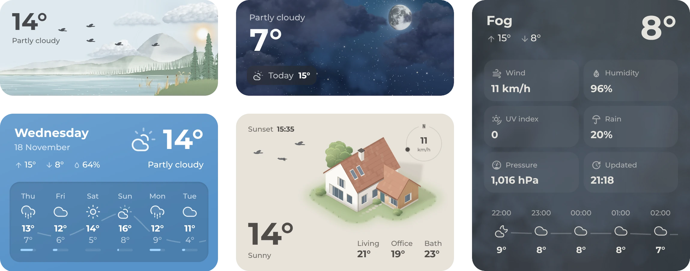
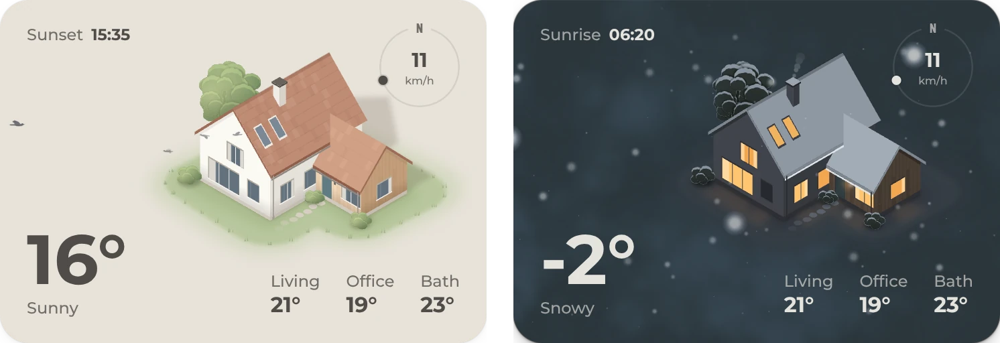

# ◪ Origami Weather

<div>
<a href="https://github.com/hazymorning/origami_weather/releases/latest"></a>
<a href="https://my.home-assistant.io/redirect/marketplace_repository/?owner=hazymorning&repository=origami_weather"></a>
<a href="https://github.com/hazymorning?tab=repositories&q=origami"></a>
</div>

<br>



Origami Weather is a weather card for Home Assistant with an animated sky behind its content. Every layout is built from single parts that can be combined freely, so a classic forecast is just as possible as something completely different. The built-in layouts are ready to use and a good starting point for new ones.

[Get started](#get-started) · [Layouts](#layouts) · [Reference](REFERENCE.md) · [More](#more)

## Get started

<details>
<summary><b>Install the card</b></summary>

<br>

Origami Weather is in the Marketplace, which replaced HACS in Home Assistant 2026.11.

1. Open Origami Weather in the Marketplace and select **Install**.

   [](https://my.home-assistant.io/redirect/marketplace_repository/?owner=hazymorning&repository=origami_weather)

2. Reload the page.

On earlier versions of Home Assistant, it's in HACS, where **Download** installs it.

Without the Marketplace or HACS, copy everything in `dist` from the [latest release](https://github.com/hazymorning/origami_weather/releases/latest), including the `diorama` folder, into a folder such as `/config/www/origami-weather`. Then add `/local/origami-weather/origami-weather.js` as a **JavaScript module** under [Resources](https://my.home-assistant.io/redirect/lovelace_resources/) and reload the page with a hard refresh. The card loads its other files and pictures from the same folder when it needs them.

</details>

<details>
<summary><b>Add the card</b></summary>

<br>

1. Edit a dashboard and add the **Origami Weather** card.
2. Choose the weather entity and a layout.
3. Change anything in the visual editor or in the code editor.

> **Choose the layout first.** Picking a layout in the visual editor replaces all of the card's settings, so customize the card after that.

</details>

## Layouts

### Diorama


A cozy landscape for every kind of weather, made for the [Origami](https://github.com/hazymorning/origami) dashboard. By default it stays simple and only shows the current weather. A tap shows a daily forecast that scrolls sideways.

### Classic


The classic weather card in a modern form: today's weather on a rich color for each kind of weather, and a forecast that scrolls sideways. Almost all effects are off for a more conventional look, and each one can be turned back on.

### Sky


The animated sky fills the whole card, with only the current weather and today's high on it. Birds, rain and snow pass in front of the temperature. A tap anywhere shows a daily forecast as a curve.

### Home



Made for dashboards about the home: a drawn house with the temperature outside and in each room, and the wind on a compass. The house reacts to what happens around it, with sunlight from the real direction of the sun, snow on the roofs and lit windows at night. An AI can also [draw the real home](#house) in its place.

<a name="more-layouts"></a>
<details>
<summary><b>More layouts</b></summary>

<br>

These layouts aren't in the layout picker. To use one, paste its YAML into the card's code editor and replace each `weather.home` with the weather entity.

<details>
<summary><b>Panel</b></summary>

<br>


A detailed overview for a bigger spot on the dashboard. Next to the current weather, tiles show the numbers that matter during the day, like the wind and the chance of rain, and the next hours follow below.

```yaml
type: custom:origami-weather
weather_entity: weather.home
color_mode: theme
card_height: content
card_padding: 20px
content_direction: row
content_align: between
sun_enabled: false
moon_enabled: false
cloud_effects: false
mist_effects: true
mist_density: 0.5
night_sky_effects: false
bird_effects: false
balloon_effects: false
plane_effects: false
background_mode: color
background_color: 'var(--ha-card-background, var(--card-background-color, #fff))'
background_thresholds:
- value: sunny
  color: 'color-mix(in srgb, rgb(255 184 77) 20%, var(--ha-card-background, var(--card-background-color, #fff)))'
  color_dark: 'color-mix(in srgb, rgb(255 184 77) 10%, var(--ha-card-background, var(--card-background-color, #fff)))'
- value: clear-night
  color: 'color-mix(in srgb, rgb(108 128 204) 16%, var(--ha-card-background, var(--card-background-color, #fff)))'
  color_dark: 'color-mix(in srgb, rgb(108 128 204) 12%, var(--ha-card-background, var(--card-background-color, #fff)))'
- value: exceptional
  color: 'color-mix(in srgb, rgb(255 140 90) 20%, var(--ha-card-background, var(--card-background-color, #fff)))'
  color_dark: 'color-mix(in srgb, rgb(255 140 90) 10%, var(--ha-card-background, var(--card-background-color, #fff)))'
- value: partlycloudy
  color: 'color-mix(in srgb, rgb(120 172 224) 20%, var(--ha-card-background, var(--card-background-color, #fff)))'
  color_dark: 'color-mix(in srgb, rgb(120 172 224) 10%, var(--ha-card-background, var(--card-background-color, #fff)))'
- value: cloudy
  color: 'color-mix(in srgb, rgb(146 158 174) 20%, var(--ha-card-background, var(--card-background-color, #fff)))'
  color_dark: 'color-mix(in srgb, rgb(146 158 174) 10%, var(--ha-card-background, var(--card-background-color, #fff)))'
- value: fog
  color: 'color-mix(in srgb, rgb(170 176 182) 24%, var(--ha-card-background, var(--card-background-color, #fff)))'
  color_dark: 'color-mix(in srgb, rgb(170 176 182) 10%, var(--ha-card-background, var(--card-background-color, #fff)))'
- value: windy
  color: 'color-mix(in srgb, rgb(108 180 176) 20%, var(--ha-card-background, var(--card-background-color, #fff)))'
  color_dark: 'color-mix(in srgb, rgb(108 180 176) 10%, var(--ha-card-background, var(--card-background-color, #fff)))'
- value: windy-variant
  color: 'color-mix(in srgb, rgb(116 168 190) 20%, var(--ha-card-background, var(--card-background-color, #fff)))'
  color_dark: 'color-mix(in srgb, rgb(116 168 190) 10%, var(--ha-card-background, var(--card-background-color, #fff)))'
- value: rainy
  color: 'color-mix(in srgb, rgb(96 140 196) 22%, var(--ha-card-background, var(--card-background-color, #fff)))'
  color_dark: 'color-mix(in srgb, rgb(96 140 196) 12%, var(--ha-card-background, var(--card-background-color, #fff)))'
- value: pouring
  color: 'color-mix(in srgb, rgb(76 112 170) 26%, var(--ha-card-background, var(--card-background-color, #fff)))'
  color_dark: 'color-mix(in srgb, rgb(76 112 170) 14%, var(--ha-card-background, var(--card-background-color, #fff)))'
- value: lightning
  color: 'color-mix(in srgb, rgb(132 108 180) 22%, var(--ha-card-background, var(--card-background-color, #fff)))'
  color_dark: 'color-mix(in srgb, rgb(132 108 180) 12%, var(--ha-card-background, var(--card-background-color, #fff)))'
- value: lightning-rainy
  color: 'color-mix(in srgb, rgb(116 98 168) 26%, var(--ha-card-background, var(--card-background-color, #fff)))'
  color_dark: 'color-mix(in srgb, rgb(116 98 168) 14%, var(--ha-card-background, var(--card-background-color, #fff)))'
- value: hail
  color: 'color-mix(in srgb, rgb(110 160 180) 22%, var(--ha-card-background, var(--card-background-color, #fff)))'
  color_dark: 'color-mix(in srgb, rgb(110 160 180) 12%, var(--ha-card-background, var(--card-background-color, #fff)))'
- value: snowy
  color: 'color-mix(in srgb, rgb(176 200 228) 26%, var(--ha-card-background, var(--card-background-color, #fff)))'
  color_dark: 'color-mix(in srgb, rgb(176 200 228) 10%, var(--ha-card-background, var(--card-background-color, #fff)))'
- value: snowy-rainy
  color: 'color-mix(in srgb, rgb(150 176 204) 24%, var(--ha-card-background, var(--card-background-color, #fff)))'
  color_dark: 'color-mix(in srgb, rgb(150 176 204) 10%, var(--ha-card-background, var(--card-background-color, #fff)))'
card_tap_action:
  action: more-info
button_containers:
- name: Now
  custom_width: 60%
  gap: 6px
  buttons:
  - name: Condition
    entity: weather.home
    width: 100%
    elements:
    - type: text
      size: 24px
      weight: '600'
      color: var(--primary-text-color)
      overflow: wrap
  - name: High and low
    entity: weather.home
    forecast: daily
    inner_gap: 2px
    icon_size: 16px
    elements:
    - type: icon
      icon: mdi:arrow-up
      color: var(--secondary-text-color)
    - type: text
      attribute: temperature
      format: °
      weight: '500'
      color: var(--primary-text-color)
      margin: 0 12px 0 0
    - type: icon
      icon: mdi:arrow-down
      color: var(--secondary-text-color)
    - type: text
      attribute: templow
      format: °
      weight: '500'
      color: var(--primary-text-color)
- name: Temperature
  custom_width: 40%
  justify_content: end
  buttons:
  - name: Temperature
    entity: weather.home
    attribute: temperature
    elements:
    - type: text
      size: 56px
      weight: '600'
      precision: 0
      format: °
      color: var(--primary-text-color)
      margin: -0.2em -0.06em -0.18em 0
- name: Wind
  custom_width: calc(50% - 4px)
  margin: 18px 0 0
  padding: 12px
  gap: 8px
  grouped: true
  background: true
  blurred_background: true
  background_color: color-mix(in srgb, var(--primary-text-color) 5%, transparent)
  shadow: false
  buttons:
  - name: Label
    entity: weather.home
    width: 100%
    inner_gap: 6px
    elements:
    - type: icon
      icon: mdi:weather-windy
      icon_size: 18px
      color: var(--secondary-text-color)
    - type: text
      text: Wind
      size: 12px
      weight: '500'
      color: var(--secondary-text-color)
  - name: Value
    entity: weather.home
    elements:
    - type: text
      size: 17px
      weight: '600'
      color: var(--primary-text-color)
      attribute: wind_speed
      precision: 0
- name: Humidity
  custom_width: calc(50% - 4px)
  margin: 18px 0 0
  padding: 12px
  gap: 8px
  grouped: true
  background: true
  blurred_background: true
  background_color: color-mix(in srgb, var(--primary-text-color) 5%, transparent)
  shadow: false
  buttons:
  - name: Label
    entity: weather.home
    width: 100%
    inner_gap: 6px
    elements:
    - type: icon
      icon: mdi:water-percent
      icon_size: 18px
      color: var(--secondary-text-color)
    - type: text
      text: Humidity
      size: 12px
      weight: '500'
      color: var(--secondary-text-color)
  - name: Value
    entity: weather.home
    elements:
    - type: text
      size: 17px
      weight: '600'
      color: var(--primary-text-color)
      attribute: humidity
- name: UV index
  custom_width: calc(50% - 4px)
  margin: 8px 0 0
  padding: 12px
  gap: 8px
  grouped: true
  background: true
  blurred_background: true
  background_color: color-mix(in srgb, var(--primary-text-color) 5%, transparent)
  shadow: false
  buttons:
  - name: Label
    entity: weather.home
    width: 100%
    inner_gap: 6px
    elements:
    - type: icon
      icon: mdi:sun-wireless-outline
      icon_size: 18px
      color: var(--secondary-text-color)
    - type: text
      text: UV index
      size: 12px
      weight: '500'
      color: var(--secondary-text-color)
  - name: Value
    entity: weather.home
    elements:
    - type: text
      size: 17px
      weight: '600'
      color: var(--primary-text-color)
      attribute: uv_index
- name: Rain
  custom_width: calc(50% - 4px)
  margin: 8px 0 0
  padding: 12px
  gap: 8px
  grouped: true
  background: true
  blurred_background: true
  background_color: color-mix(in srgb, var(--primary-text-color) 5%, transparent)
  shadow: false
  buttons:
  - name: Label
    entity: weather.home
    width: 100%
    inner_gap: 6px
    elements:
    - type: icon
      icon: mdi:umbrella-outline
      icon_size: 18px
      color: var(--secondary-text-color)
    - type: text
      text: Rain
      size: 12px
      weight: '500'
      color: var(--secondary-text-color)
  - name: Value
    entity: weather.home
    forecast: daily
    elements:
    - type: text
      size: 17px
      weight: '600'
      color: var(--primary-text-color)
      attribute: precipitation_probability
      format: '%'
- name: Feels like
  custom_width: calc(50% - 4px)
  margin: 8px 0 0
  padding: 12px
  gap: 8px
  grouped: true
  background: true
  blurred_background: true
  background_color: color-mix(in srgb, var(--primary-text-color) 5%, transparent)
  shadow: false
  buttons:
  - name: Label
    entity: weather.home
    width: 100%
    inner_gap: 6px
    elements:
    - type: icon
      icon: mdi:thermometer
      icon_size: 18px
      color: var(--secondary-text-color)
    - type: text
      text: Feels like
      size: 12px
      weight: '500'
      color: var(--secondary-text-color)
  - name: Value
    entity: weather.home
    elements:
    - type: text
      size: 17px
      weight: '600'
      color: var(--primary-text-color)
      attribute: apparent_temperature
      precision: 0
      format: °
- name: Pressure
  custom_width: calc(50% - 4px)
  margin: 8px 0 0
  padding: 12px
  gap: 8px
  grouped: true
  background: true
  blurred_background: true
  background_color: color-mix(in srgb, var(--primary-text-color) 5%, transparent)
  shadow: false
  buttons:
  - name: Label
    entity: weather.home
    width: 100%
    inner_gap: 6px
    elements:
    - type: icon
      icon: mdi:gauge
      icon_size: 18px
      color: var(--secondary-text-color)
    - type: text
      text: Pressure
      size: 12px
      weight: '500'
      color: var(--secondary-text-color)
  - name: Value
    entity: weather.home
    elements:
    - type: text
      size: 17px
      weight: '600'
      color: var(--primary-text-color)
      attribute: pressure
      precision: 0
- name: Forecast
  custom_width: 100%
  layout: horizontal-scroll
  scroll_count: 5
  margin: 18px 0 0
  padding: 4px 0
  button_style: vertical
  button_gap: 12px
  button_text_size: 12px
  button_icon_size: 24px
  align: center
  buttons:
  - name: Next hour
    entity: weather.home
    forecast: hourly
    forecast_offset: 0
    elements:
    - type: text
      attribute: datetime
      weight: '500'
      color: var(--secondary-text-color)
    - type: icon
      icon: weather
      color: var(--primary-text-color)
    - type: bar
      bar_shape: curve
      bar_height: 2px
      bar_color: color-mix(in srgb, currentColor 22%, transparent)
      margin: -44px 0 -8px
      bar_values:
      - attribute: temperature
        marker_size: 28px
        marker_gap: true
    - type: text
      attribute: temperature
      format: °
      size: 15px
      weight: '600'
      color: var(--primary-text-color)
  - name: In 2 hours
    entity: weather.home
    forecast: hourly
    forecast_offset: 1
    elements:
    - type: text
      attribute: datetime
      weight: '500'
      color: var(--secondary-text-color)
    - type: icon
      icon: weather
      color: var(--primary-text-color)
    - type: bar
      bar_shape: curve
      bar_height: 2px
      bar_color: color-mix(in srgb, currentColor 22%, transparent)
      margin: -44px 0 -8px
      bar_values:
      - attribute: temperature
        marker_size: 28px
        marker_gap: true
    - type: text
      attribute: temperature
      format: °
      size: 15px
      weight: '600'
      color: var(--primary-text-color)
  - name: In 3 hours
    entity: weather.home
    forecast: hourly
    forecast_offset: 2
    elements:
    - type: text
      attribute: datetime
      weight: '500'
      color: var(--secondary-text-color)
    - type: icon
      icon: weather
      color: var(--primary-text-color)
    - type: bar
      bar_shape: curve
      bar_height: 2px
      bar_color: color-mix(in srgb, currentColor 22%, transparent)
      margin: -44px 0 -8px
      bar_values:
      - attribute: temperature
        marker_size: 28px
        marker_gap: true
    - type: text
      attribute: temperature
      format: °
      size: 15px
      weight: '600'
      color: var(--primary-text-color)
  - name: In 4 hours
    entity: weather.home
    forecast: hourly
    forecast_offset: 3
    elements:
    - type: text
      attribute: datetime
      weight: '500'
      color: var(--secondary-text-color)
    - type: icon
      icon: weather
      color: var(--primary-text-color)
    - type: bar
      bar_shape: curve
      bar_height: 2px
      bar_color: color-mix(in srgb, currentColor 22%, transparent)
      margin: -44px 0 -8px
      bar_values:
      - attribute: temperature
        marker_size: 28px
        marker_gap: true
    - type: text
      attribute: temperature
      format: °
      size: 15px
      weight: '600'
      color: var(--primary-text-color)
  - name: In 5 hours
    entity: weather.home
    forecast: hourly
    forecast_offset: 4
    elements:
    - type: text
      attribute: datetime
      weight: '500'
      color: var(--secondary-text-color)
    - type: icon
      icon: weather
      color: var(--primary-text-color)
    - type: bar
      bar_shape: curve
      bar_height: 2px
      bar_color: color-mix(in srgb, currentColor 22%, transparent)
      margin: -44px 0 -8px
      bar_values:
      - attribute: temperature
        marker_size: 28px
        marker_gap: true
    - type: text
      attribute: temperature
      format: °
      size: 15px
      weight: '600'
      color: var(--primary-text-color)
  - name: In 6 hours
    entity: weather.home
    forecast: hourly
    forecast_offset: 5
    elements:
    - type: text
      attribute: datetime
      weight: '500'
      color: var(--secondary-text-color)
    - type: icon
      icon: weather
      color: var(--primary-text-color)
    - type: bar
      bar_shape: curve
      bar_height: 2px
      bar_color: color-mix(in srgb, currentColor 22%, transparent)
      margin: -44px 0 -8px
      bar_values:
      - attribute: temperature
        marker_size: 28px
        marker_gap: true
    - type: text
      attribute: temperature
      format: °
      size: 15px
      weight: '600'
      color: var(--primary-text-color)
  - name: In 7 hours
    entity: weather.home
    forecast: hourly
    forecast_offset: 6
    elements:
    - type: text
      attribute: datetime
      weight: '500'
      color: var(--secondary-text-color)
    - type: icon
      icon: weather
      color: var(--primary-text-color)
    - type: bar
      bar_shape: curve
      bar_height: 2px
      bar_color: color-mix(in srgb, currentColor 22%, transparent)
      margin: -44px 0 -8px
      bar_values:
      - attribute: temperature
        marker_size: 28px
        marker_gap: true
    - type: text
      attribute: temperature
      format: °
      size: 15px
      weight: '600'
      color: var(--primary-text-color)
  - name: In 8 hours
    entity: weather.home
    forecast: hourly
    forecast_offset: 7
    elements:
    - type: text
      attribute: datetime
      weight: '500'
      color: var(--secondary-text-color)
    - type: icon
      icon: weather
      color: var(--primary-text-color)
    - type: bar
      bar_shape: curve
      bar_height: 2px
      bar_color: color-mix(in srgb, currentColor 22%, transparent)
      margin: -44px 0 -8px
      bar_values:
      - attribute: temperature
        marker_size: 28px
        marker_gap: true
    - type: text
      attribute: temperature
      format: °
      size: 15px
      weight: '600'
      color: var(--primary-text-color)
  - name: In 9 hours
    entity: weather.home
    forecast: hourly
    forecast_offset: 8
    elements:
    - type: text
      attribute: datetime
      weight: '500'
      color: var(--secondary-text-color)
    - type: icon
      icon: weather
      color: var(--primary-text-color)
    - type: bar
      bar_shape: curve
      bar_height: 2px
      bar_color: color-mix(in srgb, currentColor 22%, transparent)
      margin: -44px 0 -8px
      bar_values:
      - attribute: temperature
        marker_size: 28px
        marker_gap: true
    - type: text
      attribute: temperature
      format: °
      size: 15px
      weight: '600'
      color: var(--primary-text-color)
  - name: In 10 hours
    entity: weather.home
    forecast: hourly
    forecast_offset: 9
    elements:
    - type: text
      attribute: datetime
      weight: '500'
      color: var(--secondary-text-color)
    - type: icon
      icon: weather
      color: var(--primary-text-color)
    - type: bar
      bar_shape: curve
      bar_height: 2px
      bar_color: color-mix(in srgb, currentColor 22%, transparent)
      margin: -44px 0 -8px
      bar_values:
      - attribute: temperature
        marker_size: 28px
        marker_gap: true
    - type: text
      attribute: temperature
      format: °
      size: 15px
      weight: '600'
      color: var(--primary-text-color)
  - name: In 11 hours
    entity: weather.home
    forecast: hourly
    forecast_offset: 10
    elements:
    - type: text
      attribute: datetime
      weight: '500'
      color: var(--secondary-text-color)
    - type: icon
      icon: weather
      color: var(--primary-text-color)
    - type: bar
      bar_shape: curve
      bar_height: 2px
      bar_color: color-mix(in srgb, currentColor 22%, transparent)
      margin: -44px 0 -8px
      bar_values:
      - attribute: temperature
        marker_size: 28px
        marker_gap: true
    - type: text
      attribute: temperature
      format: °
      size: 15px
      weight: '600'
      color: var(--primary-text-color)
  - name: In 12 hours
    entity: weather.home
    forecast: hourly
    forecast_offset: 11
    elements:
    - type: text
      attribute: datetime
      weight: '500'
      color: var(--secondary-text-color)
    - type: icon
      icon: weather
      color: var(--primary-text-color)
    - type: bar
      bar_shape: curve
      bar_height: 2px
      bar_color: color-mix(in srgb, currentColor 22%, transparent)
      margin: -44px 0 -8px
      bar_values:
      - attribute: temperature
        marker_size: 28px
        marker_gap: true
    - type: text
      attribute: temperature
      format: °
      size: 15px
      weight: '600'
      color: var(--primary-text-color)
  - name: In 13 hours
    entity: weather.home
    forecast: hourly
    forecast_offset: 12
    elements:
    - type: text
      attribute: datetime
      weight: '500'
      color: var(--secondary-text-color)
    - type: icon
      icon: weather
      color: var(--primary-text-color)
    - type: bar
      bar_shape: curve
      bar_height: 2px
      bar_color: color-mix(in srgb, currentColor 22%, transparent)
      margin: -44px 0 -8px
      bar_values:
      - attribute: temperature
        marker_size: 28px
        marker_gap: true
    - type: text
      attribute: temperature
      format: °
      size: 15px
      weight: '600'
      color: var(--primary-text-color)
  - name: In 14 hours
    entity: weather.home
    forecast: hourly
    forecast_offset: 13
    elements:
    - type: text
      attribute: datetime
      weight: '500'
      color: var(--secondary-text-color)
    - type: icon
      icon: weather
      color: var(--primary-text-color)
    - type: bar
      bar_shape: curve
      bar_height: 2px
      bar_color: color-mix(in srgb, currentColor 22%, transparent)
      margin: -44px 0 -8px
      bar_values:
      - attribute: temperature
        marker_size: 28px
        marker_gap: true
    - type: text
      attribute: temperature
      format: °
      size: 15px
      weight: '600'
      color: var(--primary-text-color)
  - name: In 15 hours
    entity: weather.home
    forecast: hourly
    forecast_offset: 14
    elements:
    - type: text
      attribute: datetime
      weight: '500'
      color: var(--secondary-text-color)
    - type: icon
      icon: weather
      color: var(--primary-text-color)
    - type: bar
      bar_shape: curve
      bar_height: 2px
      bar_color: color-mix(in srgb, currentColor 22%, transparent)
      margin: -44px 0 -8px
      bar_values:
      - attribute: temperature
        marker_size: 28px
        marker_gap: true
    - type: text
      attribute: temperature
      format: °
      size: 15px
      weight: '600'
      color: var(--primary-text-color)
  - name: In 16 hours
    entity: weather.home
    forecast: hourly
    forecast_offset: 15
    elements:
    - type: text
      attribute: datetime
      weight: '500'
      color: var(--secondary-text-color)
    - type: icon
      icon: weather
      color: var(--primary-text-color)
    - type: bar
      bar_shape: curve
      bar_height: 2px
      bar_color: color-mix(in srgb, currentColor 22%, transparent)
      margin: -44px 0 -8px
      bar_values:
      - attribute: temperature
        marker_size: 28px
        marker_gap: true
    - type: text
      attribute: temperature
      format: °
      size: 15px
      weight: '600'
      color: var(--primary-text-color)
  - name: In 17 hours
    entity: weather.home
    forecast: hourly
    forecast_offset: 16
    elements:
    - type: text
      attribute: datetime
      weight: '500'
      color: var(--secondary-text-color)
    - type: icon
      icon: weather
      color: var(--primary-text-color)
    - type: bar
      bar_shape: curve
      bar_height: 2px
      bar_color: color-mix(in srgb, currentColor 22%, transparent)
      margin: -44px 0 -8px
      bar_values:
      - attribute: temperature
        marker_size: 28px
        marker_gap: true
    - type: text
      attribute: temperature
      format: °
      size: 15px
      weight: '600'
      color: var(--primary-text-color)
  - name: In 18 hours
    entity: weather.home
    forecast: hourly
    forecast_offset: 17
    elements:
    - type: text
      attribute: datetime
      weight: '500'
      color: var(--secondary-text-color)
    - type: icon
      icon: weather
      color: var(--primary-text-color)
    - type: bar
      bar_shape: curve
      bar_height: 2px
      bar_color: color-mix(in srgb, currentColor 22%, transparent)
      margin: -44px 0 -8px
      bar_values:
      - attribute: temperature
        marker_size: 28px
        marker_gap: true
    - type: text
      attribute: temperature
      format: °
      size: 15px
      weight: '600'
      color: var(--primary-text-color)
  - name: In 19 hours
    entity: weather.home
    forecast: hourly
    forecast_offset: 18
    elements:
    - type: text
      attribute: datetime
      weight: '500'
      color: var(--secondary-text-color)
    - type: icon
      icon: weather
      color: var(--primary-text-color)
    - type: bar
      bar_shape: curve
      bar_height: 2px
      bar_color: color-mix(in srgb, currentColor 22%, transparent)
      margin: -44px 0 -8px
      bar_values:
      - attribute: temperature
        marker_size: 28px
        marker_gap: true
    - type: text
      attribute: temperature
      format: °
      size: 15px
      weight: '600'
      color: var(--primary-text-color)
  - name: In 20 hours
    entity: weather.home
    forecast: hourly
    forecast_offset: 19
    elements:
    - type: text
      attribute: datetime
      weight: '500'
      color: var(--secondary-text-color)
    - type: icon
      icon: weather
      color: var(--primary-text-color)
    - type: bar
      bar_shape: curve
      bar_height: 2px
      bar_color: color-mix(in srgb, currentColor 22%, transparent)
      margin: -44px 0 -8px
      bar_values:
      - attribute: temperature
        marker_size: 28px
        marker_gap: true
    - type: text
      attribute: temperature
      format: °
      size: 15px
      weight: '600'
      color: var(--primary-text-color)
  - name: In 21 hours
    entity: weather.home
    forecast: hourly
    forecast_offset: 20
    elements:
    - type: text
      attribute: datetime
      weight: '500'
      color: var(--secondary-text-color)
    - type: icon
      icon: weather
      color: var(--primary-text-color)
    - type: bar
      bar_shape: curve
      bar_height: 2px
      bar_color: color-mix(in srgb, currentColor 22%, transparent)
      margin: -44px 0 -8px
      bar_values:
      - attribute: temperature
        marker_size: 28px
        marker_gap: true
    - type: text
      attribute: temperature
      format: °
      size: 15px
      weight: '600'
      color: var(--primary-text-color)
  - name: In 22 hours
    entity: weather.home
    forecast: hourly
    forecast_offset: 21
    elements:
    - type: text
      attribute: datetime
      weight: '500'
      color: var(--secondary-text-color)
    - type: icon
      icon: weather
      color: var(--primary-text-color)
    - type: bar
      bar_shape: curve
      bar_height: 2px
      bar_color: color-mix(in srgb, currentColor 22%, transparent)
      margin: -44px 0 -8px
      bar_values:
      - attribute: temperature
        marker_size: 28px
        marker_gap: true
    - type: text
      attribute: temperature
      format: °
      size: 15px
      weight: '600'
      color: var(--primary-text-color)
  - name: In 23 hours
    entity: weather.home
    forecast: hourly
    forecast_offset: 22
    elements:
    - type: text
      attribute: datetime
      weight: '500'
      color: var(--secondary-text-color)
    - type: icon
      icon: weather
      color: var(--primary-text-color)
    - type: bar
      bar_shape: curve
      bar_height: 2px
      bar_color: color-mix(in srgb, currentColor 22%, transparent)
      margin: -44px 0 -8px
      bar_values:
      - attribute: temperature
        marker_size: 28px
        marker_gap: true
    - type: text
      attribute: temperature
      format: °
      size: 15px
      weight: '600'
      color: var(--primary-text-color)
  - name: In 24 hours
    entity: weather.home
    forecast: hourly
    forecast_offset: 23
    elements:
    - type: text
      attribute: datetime
      weight: '500'
      color: var(--secondary-text-color)
    - type: icon
      icon: weather
      color: var(--primary-text-color)
    - type: bar
      bar_shape: curve
      bar_height: 2px
      bar_color: color-mix(in srgb, currentColor 22%, transparent)
      margin: -44px 0 -8px
      bar_values:
      - attribute: temperature
        marker_size: 28px
        marker_gap: true
    - type: text
      attribute: temperature
      format: °
      size: 15px
      weight: '600'
      color: var(--primary-text-color)
```

</details>

<details>
<summary><b>Centered</b></summary>

<br>


A calm card for a quick look, with the temperature in the middle and only today's high and low and the wind below it. Clouds and mist drift slowly behind it.

```yaml
type: custom:origami-weather
weather_entity: weather.home
sun_moon_x: dynamic
card_height: content
card_padding: 34px 20px
content_align: between
content_align_items: center
button_containers:
- name: Temperature
  margin: 0 0 24px 0
  align: center
  buttons:
  - name: Temperature and condition
    entity: weather.home
    style: vertical
    text_size: 58px
    inner_gap: 0px
    elements:
    - type: text
      weight: '700'
      attribute: temperature
      precision: 0
      fancy_unit: true
    - type: text
      size: 15px
      weight: '500'
      entity: weather.home
      margin: -3.5px 0 -1.5px
- name: Details
  gap: clamp(11px, 5.5cqw, 18px)
  margin: 0 0 7px
  button_gap: 5px
  button_icon_size: 15px
  button_text_size: 13px
  justify_content: center
  buttons:
  - name: High
    entity: weather.home
    forecast: daily
    elements:
    - type: icon
      icon: mdi:arrow-up
      margin: 0 -2px 0 -1.8px
    - type: text
      weight: '500'
      attribute: temperature
      format: °
  - name: Low
    entity: weather.home
    forecast: daily
    elements:
    - type: icon
      icon: mdi:arrow-down
      margin: 0 -2px 0 -1.8px
    - type: text
      weight: '500'
      attribute: templow
      format: °
  - name: Wind
    entity: weather.home
    elements:
    - type: icon
      icon: mdi:weather-windy
      margin: 0 1px 0 -1.5px
    - type: text
      weight: '700'
      attribute: wind_speed
      precision: 0
```

</details>

<details>
<summary><b>Outlook</b></summary>

<br>


For a quick look at how the day develops. The temperature outside sits next to the coming days, and a bar shows how close it is to today's high, with the current weather and the chance of rain below.

```yaml
type: custom:origami-weather
weather_entity: weather.home
sun_enabled: false
moon_enabled: false
card_height: content
card_padding: 20px
card_offset: 8px 0px 0px 0px
color_mode: theme
background_mode: color
background_threshold_entity: weather.home
background_thresholds:
- value: sunny
  color: color-mix(in srgb, var(--ha-card-background, var(--card-background-color)) 80%, rgb(245,185,70))
- value: clear-night
  color: color-mix(in srgb, var(--ha-card-background, var(--card-background-color)) 80%, rgb(80,90,180))
- value: partlycloudy
  color: color-mix(in srgb, var(--ha-card-background, var(--card-background-color)) 82%, rgb(120,175,225))
- value: cloudy
  color: color-mix(in srgb, var(--ha-card-background, var(--card-background-color)) 84%, rgb(145,155,175))
- value: fog
  color: color-mix(in srgb, var(--ha-card-background, var(--card-background-color)) 84%, rgb(185,185,200))
- value: windy
  color: color-mix(in srgb, var(--ha-card-background, var(--card-background-color)) 84%, rgb(90,190,175))
- value: windy-variant
  color: color-mix(in srgb, var(--ha-card-background, var(--card-background-color)) 84%, rgb(110,170,200))
- value: rainy
  color: color-mix(in srgb, var(--ha-card-background, var(--card-background-color)) 80%, rgb(70,130,200))
- value: pouring
  color: color-mix(in srgb, var(--ha-card-background, var(--card-background-color)) 76%, rgb(45,95,190))
- value: lightning
  color: color-mix(in srgb, var(--ha-card-background, var(--card-background-color)) 80%, rgb(150,105,220))
- value: lightning-rainy
  color: color-mix(in srgb, var(--ha-card-background, var(--card-background-color)) 76%, rgb(115,85,205))
- value: hail
  color: color-mix(in srgb, var(--ha-card-background, var(--card-background-color)) 80%, rgb(100,185,210))
- value: snowy
  color: color-mix(in srgb, var(--ha-card-background, var(--card-background-color)) 80%, rgb(180,215,245))
- value: snowy-rainy
  color: color-mix(in srgb, var(--ha-card-background, var(--card-background-color)) 80%, rgb(135,175,215))
- value: exceptional
  color: color-mix(in srgb, var(--ha-card-background, var(--card-background-color)) 76%, rgb(230,95,65))
precipitation_effects: false
cloud_effects: false
night_sky_effects: false
button_containers:
- buttons:
  - entity: weather.home
    style: vertical
    elements:
    - type: text
      text: Outside
      size: 14px
      weight: '500'
    - type: text
      attribute: temperature
      precision: 0
      format: °
      size: 42px
      weight: '700'
- position: custom
  position_anchor: top-right
  layout: horizontal-scroll
  custom_width: 60%
  scroll_count: 3
  gap: 8px
  background: true
  button_style: vertical
  button_padding: 16px 12px
  button_icon_size: 26px
  button_icon_padding: 0 0 8px 0
  button_shadow: false
  button_blurred_background: true
  align: center
  buttons:
  - entity: weather.home
    forecast: daily
    background_color: rgba(150,150,150,0.14)
    elements:
    - type: icon
      icon: weather
    - type: text
      size: 12px
      weight: '500'
      attribute: datetime
    - type: text
      weight: '700'
      attribute: temperature
      format: °
  - entity: weather.home
    forecast: daily
    forecast_offset: 1
    background_color: rgba(150,150,150,0.12)
    elements:
    - type: icon
      icon: weather
    - type: text
      size: 12px
      weight: '500'
      attribute: datetime
    - type: text
      weight: '700'
      attribute: temperature
      format: °
  - entity: weather.home
    forecast: daily
    forecast_offset: 2
    background_color: rgba(150,150,150,0.1)
    elements:
    - type: icon
      icon: weather
    - type: text
      size: 12px
      weight: '500'
      attribute: datetime
    - type: text
      weight: '700'
      attribute: temperature
      format: °
  - entity: weather.home
    forecast: daily
    forecast_offset: 3
    background_color: rgba(150,150,150,0.08)
    elements:
    - type: icon
      icon: weather
    - type: text
      size: 12px
      weight: '500'
      attribute: datetime
    - type: text
      weight: '700'
      attribute: temperature
      format: °
  - entity: weather.home
    forecast: daily
    forecast_offset: 4
    background_color: rgba(150,150,150,0.08)
    elements:
    - type: icon
      icon: weather
    - type: text
      size: 12px
      weight: '500'
      attribute: datetime
    - type: text
      weight: '700'
      attribute: temperature
      format: °
  - entity: weather.home
    forecast: daily
    forecast_offset: 5
    background_color: rgba(150,150,150,0.08)
    elements:
    - type: icon
      icon: weather
    - type: text
      size: 12px
      weight: '500'
      attribute: datetime
    - type: text
      weight: '700'
      attribute: temperature
      format: °
  - entity: weather.home
    forecast: daily
    forecast_offset: 6
    background_color: rgba(150,150,150,0.08)
    elements:
    - type: icon
      icon: weather
    - type: text
      size: 12px
      weight: '500'
      attribute: datetime
    - type: text
      weight: '700'
      attribute: temperature
      format: °
  - entity: weather.home
    forecast: daily
    forecast_offset: 7
    background_color: rgba(150,150,150,0.08)
    elements:
    - type: icon
      icon: weather
    - type: text
      size: 12px
      weight: '500'
      attribute: datetime
    - type: text
      weight: '700'
      attribute: temperature
      format: °
  - entity: weather.home
    forecast: daily
    forecast_offset: 8
    background_color: rgba(150,150,150,0.08)
    elements:
    - type: icon
      icon: weather
    - type: text
      size: 12px
      weight: '500'
      attribute: datetime
    - type: text
      weight: '700'
      attribute: temperature
      format: °
  - entity: weather.home
    forecast: daily
    forecast_offset: 9
    background_color: rgba(150,150,150,0.08)
    elements:
    - type: icon
      icon: weather
    - type: text
      size: 12px
      weight: '500'
      attribute: datetime
    - type: text
      weight: '700'
      attribute: temperature
      format: °
- margin: 66px 0 8px 0
  buttons:
  - entity: weather.home
    forecast: daily
    width: 100%
    elements:
    - type: bar
      bar_min: '-10'
      bar_max: '35'
      bar_height: 2px
      bar_color: rgba(150,150,150,0.6)
      bar_marker_size: 10px
      bar_values:
      - entity: weather.home
        attribute: temperature
        marker_color: '#ffffff'
      - attribute: temperature
- padding: 0 4px
  margin: 12px 0 0 0
  button_text_size: 16px
  buttons:
  - entity: weather.home
    align: spread
    elements:
    - type: icon
      icon: weather
      padding: 0 4px 0 0
    - type: text
      weight: '700'
      margin: 0 auto 0 0
  - entity: weather.home
    forecast: daily
    align: spread
    elements:
    - type: icon
      icon: mdi:umbrella-outline
      margin: 0 0 0 auto
    - type: text
      attribute: precipitation_probability
      format: ' %'
      weight: '400'
```

</details>

</details>

<sub>The screenshots use the Montserrat font. The [Origami](https://github.com/hazymorning/origami#get-started) repository explains how to add it to Home Assistant.</sub>

## More

<a name="backgrounds"></a>
<a name="pictures"></a>
<details>
<summary><b>Backgrounds and effects</b></summary>

<br>

Behind the content, the card draws an animated sky that matches the weather and the time of day. Its colors change from day to night, the sun and the moon rise and set, and at night the stars come out, with the occasional shooting star. Clouds, mist, rain and snow follow the current weather, the clouds and the mist drift with the wind, and birds, balloons and planes cross the sky now and then.

The sky and every effect can be turned off one by one, rain and snow with a single switch. The effects also work on the other backgrounds that `background_mode` offers: a picture for each kind of weather, a color, the plain card background or none at all. Without any of it, the card looks like a plain Home Assistant card with just its content.

With `background_mode: none` and `card_frame: false`, the card drops its own frame and blends into the dashboard, and `full_width: true` stretches it across the full width. This is mainly useful in special places like a dashboard header. The [reference](REFERENCE.md#background) lists every option.

#### Pictures for each kind of weather

The Diorama's pictures come with the card, so Home Assistant serves them itself and nothing is loaded from the internet. Any layout can show its own picture for each kind of weather, and the Diorama can use other pictures too.

1. Name the pictures after the weather conditions, like the Diorama's own pictures in [`dist/diorama`](https://github.com/hazymorning/origami_weather/tree/main/dist/diorama): `sunny.webp`, `partlycloudy.webp`, `clear-night.webp` and so on.
2. Copy them into a folder in `/config/www`, such as `/config/www/weather`. Pictures for dark mode go into a second folder.
3. Under **Background**, set the background to **Custom images**, the light mode folder to `/local/weather/` and the dark mode folder to the second folder, or leave it empty if there is none. In YAML, these are `background_mode: images`, `weather_image_path` and `weather_image_path_dark`.

For a Diorama card, also set the **File type** to the type of the pictures, or to **Automatic**, and turn off **In front of the sun, the moon and the stars** unless the pictures have a transparent sky.

Updates replace everything in the card's own folder, so keep other pictures in a folder outside of it.

</details>

<a name="house"></a>
<details>
<summary><b>The house in the Home layout</b></summary>

<br>

Because the card draws the house itself, the house can react to what happens around it. Sunlight comes from the sun's real direction and the shadows move across the lawn during the day, the roofs and the lawn turn white while it snows, and in dark mode the windows light up. Each room shows the weather entity's temperature until it gets a room sensor.

The house from previous versions is still available: `image: old-home` on the container brings it back.

#### Draw a real home with AI

An AI can draw a real home and build the card around it, in any style and with as much of the surroundings as fits, from a bit of lawn to the whole garden or the hills behind it. Use the most capable model available: it has to understand photos, draw clean pictures and read the card's source code, which together with the README and the reference is well over 300 KB of text. A model that can run code does better, because it can check its pictures before handing them over.

A drawn home is a normal picture file, and the card can't change anything inside it. Everything that should change, like the night, a room's light, the sunlight or snow, therefore becomes a separate picture that lies exactly on top of the house, and the card shows or fades these pictures as needed. A day picture and a night picture are enough to start with.

1. Download [`README.md`](README.md), [`REFERENCE.md`](REFERENCE.md) and the card itself, [`src/origami-weather.js`](src/origami-weather.js), from this repository.
2. Take photos of the home from the front, the back and two corners, and of anything around it that should be in the picture.
3. Find out which way the front of the house faces, on a map for example.
4. Look up the entity IDs of the room sensors and of the lights that should light up windows, under **Settings → Devices & services → Entities**.
5. Copy the YAML of a card with the Home layout from the code editor.
6. Give it all to the AI with this text and fill in the brackets. They hold examples, so a pixel art style, the hills behind the house or a picture across the whole card work just as well.

```text
I'm using the Origami Weather card for Home Assistant and want my own home in its Home layout. Attached are the card's README and REFERENCE, its source code (origami-weather.js), my card YAML and photos of my home.

Draw my home as it really is, in a [watercolor] style, with [our garden with the apple tree and the hedge] around it. Put it [where the layout's picture is], in front of [the card's own sky with the sun, the moon, clouds and stars]. The front of the house faces [south-west]. The rooms are [the living room with sensor.living_room_temperature and the two big windows on the garden side] and [...]. [light.living_room] should light up the windows of [the living room], and [...]. Besides day and night, the picture should change with [the lights, the sun and snow].

Read everything before you start. Work out from origami-weather.js how containers show image and image_dark, how free-positioned containers stack, and how visibility and the css option work. For css, the card sets the classes scheme-light or scheme-dark and weather-<condition> on #card-root. It also sets --origami-sun-x and --origami-sun-y for the direction of the sun (x is 1 in the east and -1 in the west, y is 1 in the north and -1 in the south), --origami-sun-light for the strength of the sunlight from 0 to 1, and --origami-sun-shadow for the length of a shadow compared to the height of what casts it.

My pictures are image files, so the card can't change anything inside them. Every change needs a picture of its own, in its own container with exactly the same position and width as the house, stacked in the right order. Draw all pictures on the same canvas so they line up, and let an overlay hold only what changes and only what can be seen. SVG makes this easiest. If the style needs painted pictures, use PNG or WebP with transparency and keep the framing exactly the same.

Show lit windows and the light they throw outside while their light is on, and snow while the weather is snowy or snowy-rainy. Fade and move the sunlight and the shadows with the sun through the css option, with fallbacks for missing values, and pick each picture by its file name, like img.group-image[src*="sun-east"]. Keep the house recognizable, but simple enough to read at the size it gets in the card, and leave the background transparent where the card should show through. Use my sensors for the rooms. If the temperatures sit on the picture, place them as free-positioned buttons with offsets in %.

Show me your plan and my home in daylight first, and wait for my OK before you make the rest. If you can run code, check every picture in light and dark mode, in the morning, at noon and in the evening, and with each light on and off. Then give me the files, where they go (/config/www/home/, used as /local/home/...) and the complete card YAML.
```

The pictures go into `/config/www/home`, for example with the File editor add-on or a Samba share. If the `www` folder is new, Home Assistant has to be restarted once before it serves it. After pasting the YAML into the card's code editor, a hard refresh shows the new pictures. Browsers cache pictures for a while, so a changed picture needs a hard refresh as well.

It rarely works out on the first try. Screenshots of the card with one or two concrete requests at a time work best, like a flatter roof or a taller tree. Error messages can be passed to the AI as they are.

Once it works, it's worth playing with the settings. The Home layout turns off the sun, the moon, the clouds, the stars, the balloons and the planes, which leaves birds, rain, snow and a light mist. The house sits in the middle of the weather: birds, rain and snow pass in front of it, while the sun, the moon, the stars and most of the mist stay behind it, as do the clouds, balloons and planes when they're turned on. Turning effects back on or trying another background can change the whole look, and almost everything in the README and the reference can be used, so let the AI experiment.

</details>

<a name="reference"></a>
<details>
<summary><b>Reference</b></summary>

<br>

The [reference](REFERENCE.md) describes every block and option of the card.

All layouts are built from the same blocks. Containers hold buttons, and each button shows an entity with texts, icons, bars or a ring. A container can also show a picture, such as a floor plan with each room's temperature on it, or hold other Home Assistant cards. Containers can sit in front of the sky and the weather or further back, so rain and birds can pass in front of a picture of a house.

A tap on a button or on the card can show and hide parts of the card through the card's own switches, without helpers in Home Assistant. Containers and buttons can also have a name, which only the visual editor shows, so the parts of a bigger layout are easy to tell apart.

For a new layout, the YAML of an existing one is a good starting point.

</details>

<details>
<summary><b>Performance</b></summary>

<br>

An animated weather card has to run on all kinds of devices, so a lot of care went into keeping this one light. That's why there are no extra performance settings: the card already runs at the lowest level that still lets it do what it's meant to do. Pictures like the clouds, the birds and the house are only loaded once a card shows them, and the editor only when a card is edited.

If it still feels too heavy on a device, most features can be turned off one by one. Plain weather pictures, or no decorative effects at all, make it even lighter.

</details>

<details>
<summary><b>Coming from an earlier version</b></summary>

<br>

Updating the card keeps the settings of every card. A layout only changes when it's picked again in the layout picker.

Centered, Comparison and Arc are no longer in the layout picker, and cards made with them keep working. **More layouts** has the YAML of Centered and of Comparison, which is now called Outlook. Slim is now called Sky, and cards made with Slim keep working as they are. Cards with `image: demo-home-image` keep the house from previous versions, while the Home layout now uses the new one with `image: home`. A Diorama card made from Origami's `diorama.yaml` keeps loading its pictures from jsDelivr until Diorama is picked in the layout picker.

Mist now drifts behind the clouds, and `mist_effects: false` turns it off.

The corners of button backgrounds now follow the size of the button: 35% of its height, or of its width if that is smaller, and never rounder than the card. Small buttons no longer turn into capsules on themes with very round cards, and `--origami-bottom-bg-radius` still sets any radius.

The card's border is now drawn on top of the card's background. A see-through border color from the theme no longer lets the dashboard show through at the edge, and the content can reach the very edge of the card.

Containers can now sit between the weather layers with `layer`. Custom CSS that set a `z-index` on `#free-layer` or `#content-layer` to put a picture behind the rain no longer works for that, and `layer: middle` on the picture's container does it now.

Without the Marketplace or HACS, the card now comes as several files that all belong in one folder. Copy everything in `dist`, including the `diorama` folder, as **Install the card** describes.

</details>

<sub>Origami Weather continues a hobby project from early 2026, first called Atmospheric Weather Card on an earlier GitHub account. AI is used as a tool in this project.</sub>
