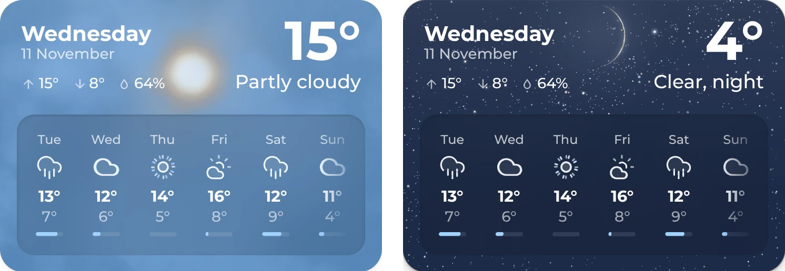

# ◪ Origami Weather

<div>
<a href="https://github.com/hazymorning/origami_weather/releases/latest"></a>
<a href="https://my.home-assistant.io/redirect/marketplace_repository/?owner=hazymorning&repository=origami_weather"></a>
<a href="https://github.com/hazymorning?tab=repositories&q=origami"></a>
</div>

<br>


Origami Weather is a weather card for Home Assistant with a builder approach. It can be a visual, animated weather card, a classic info-rich one, or something completely different. It comes with several ready-made layouts, but every part can be changed or mixed and matched freely.

[](https://my.home-assistant.io/redirect/marketplace_repository/?owner=hazymorning&repository=origami_weather)

[Get started](#get-started) · [Layouts](#layouts) · [Reference](REFERENCE.md) · [More](#more)

## Get started

<details>
<summary><b>Install the card</b></summary>

<br>

Install Origami Weather from the Marketplace with the button above, then reload the page. On Home Assistant versions before 2026.11, it's in [HACS](https://my.home-assistant.io/redirect/hacs_repository/?owner=hazymorning&repository=origami_weather&category=plugin) instead.

Without the Marketplace or HACS, copy everything in `dist` from the [latest release](https://github.com/hazymorning/origami_weather/releases/latest), including the `diorama` folder, into a folder such as `/config/www/origami-weather`. Then add `/local/origami-weather/origami-weather.js` as a **JavaScript module** under [Resources](https://my.home-assistant.io/redirect/lovelace_resources/) and reload the page with a hard refresh.

</details>

<details>
<summary><b>Add the card</b></summary>

<br>

1. Edit a dashboard and add the **Origami Weather** card.
2. Pick the weather entity and a layout.
3. Change anything in the visual editor or the code editor.

> **Pick the layout first.** Choosing a layout replaces all of the card's settings.

</details>

## Layouts

All of these layouts are ready to use. Just pick one in the cards editor.


<details>
<summary><b>More about the layouts</b></summary>

<br>

### Diorama


A chill little paper landscape that changes with the weather and the time of day, made for the [Origami](https://github.com/hazymorning/origami) dashboard.

### Classic



A familiar weather card with the current conditions at the top and the forecast for the next days in a row that scrolls sideways.

### Sky


This layout gives room to the various weather effects. A tap on the card opens a forecast view.

### Home


A little house that reacts to the sun and the weather, made for dashboards about the home. An AI can also [draw a real home](#house) in its place.

### Panel


A detailed weather overview for a larger spot on the dashboard.

<sub>The screenshots use the Montserrat font. The [Origami](https://github.com/hazymorning/origami#get-started) README explains how to add it to Home Assistant.</sub>

</details>

## More

<a name="backgrounds"></a>
<a name="pictures"></a>
<details>
<summary><b>Backgrounds and effects</b></summary>

<br>

The animated sky follows the weather and the time of day, with the sun and the moon, stars, clouds, mist, rain and snow, and now and then a few birds, a balloon or a plane. Every effect can be turned off on its own, and all of them also work on the other backgrounds: a picture for each kind of weather, a single color, the theme's card background, or none at all. The [reference](REFERENCE.md#background) lists every option.

#### Pictures for each kind of weather

Any layout can show its own picture for each kind of weather, like the Diorama does.

1. Name the pictures after the weather conditions, like the Diorama's pictures in [`dist/diorama`](https://github.com/hazymorning/origami_weather/tree/main/dist/diorama): `sunny.webp`, `partlycloudy.webp`, `clear-night.webp` and so on.
2. Copy them into a folder in `/config/www`, such as `/config/www/weather`, and pictures for dark mode into a second folder.
3. Under **Background**, choose **Custom images** and enter the folders, like `/local/weather/`. In YAML, these are `background_mode: images`, `weather_image_path` and `weather_image_path_dark`.

For a Diorama card, also set the **File type**, and turn off **In front of the sun, the moon and the stars** unless the pictures have a transparent sky. Keep the pictures outside the card's own folder, since updates replace everything in it.

</details>

<a name="house"></a>
<details>
<summary><b>The house in the Home layout</b></summary>

<br>

The card draws the house itself, so it can react to the weather: sunlight and shadows follow the real sun, snow settles on the roofs, and the windows light up at night. Each room shows the outside temperature until it gets its own sensor. The house from earlier versions is still there with `image: old-home` on its container.

#### Draw a real home with AI

An AI can draw a real home in any style and build the card around it. Use the most capable model available, since it has to understand photos, draw clean pictures and read the card's source code. Everything that changes, like the night, a lit room or snow, becomes a separate picture on top of the house. A day and a night picture are enough to start with.

1. Download [`README.md`](README.md), [`REFERENCE.md`](REFERENCE.md) and [`src/origami-weather.js`](src/origami-weather.js) from this repository.
2. Take photos of the home from the front, the back and two corners.
3. Find out which way the front of the house faces, for example on a map.
4. Look up the entity IDs of the room sensors and of the lights that should light up windows, under **Settings → Devices & services → Entities**.
5. Copy the YAML of a card with the Home layout from the code editor.
6. Give it all to the AI with this text, and fill in the brackets:

```text
I'm using the Origami Weather card for Home Assistant and want my own home in its Home layout. Attached are the card's README and REFERENCE, its source code (origami-weather.js), my card YAML and photos of my home.

Draw my home as it really is, in a [watercolor] style, with [our garden with the apple tree and the hedge] around it. Put it [where the layout's picture is], in front of [the card's own sky with the sun, the moon, clouds and stars]. The front of the house faces [south-west]. The rooms are [the living room with sensor.living_room_temperature and the two big windows on the garden side] and [...]. [light.living_room] should light up the windows of [the living room], and [...]. Besides day and night, the picture should change with [the lights, the sun and snow].

Read everything before you start. Work out from origami-weather.js how containers show image and image_dark, how free-positioned containers stack, and how visibility and the css option work. For css, the card sets the classes scheme-light or scheme-dark and weather-<condition> on #card-root. It also sets --origami-sun-x and --origami-sun-y for the direction of the sun (x is 1 in the east and -1 in the west, y is 1 in the north and -1 in the south), --origami-sun-light for the strength of the sunlight from 0 to 1, and --origami-sun-shadow for the length of a shadow compared to the height of what casts it.

My pictures are image files, so the card can't change anything inside them. Every change needs a picture of its own, in its own container with exactly the same position and width as the house, stacked in the right order. Draw all pictures on the same canvas so they line up, and let an overlay hold only what changes and only what can be seen. SVG makes this easiest. If the style needs painted pictures, use PNG or WebP with transparency and keep the framing exactly the same.

Show lit windows and the light they throw outside while their light is on, and snow while the weather is snowy or snowy-rainy. Fade and move the sunlight and the shadows with the sun through the css option, with fallbacks for missing values, and pick each picture by its file name, like img.group-image[src*="sun-east"]. Keep the house recognizable, but simple enough to read at the size it gets in the card, and leave the background transparent where the card should show through. Use my sensors for the rooms. If the temperatures sit on the picture, place them as free-positioned buttons with offsets in %.

Show me your plan and my home in daylight first, and wait for my OK before you make the rest. If you can run code, check every picture in light and dark mode, in the morning, at noon and in the evening, and with each light on and off. Then give me the files, where they go (/config/www/home/, used as /local/home/...) and the complete card YAML.
```

The pictures go into `/config/www/home`. If the `www` folder is new, restart Home Assistant once. After pasting the YAML into the code editor, and after every changed picture, reload the page with a hard refresh. It rarely works on the first try, so ask for one or two specific changes at a time, with a screenshot.

</details>

<a name="reference"></a>
<details>
<summary><b>How it's built</b></summary>

<br>

Every layout is made of the same parts: containers hold buttons, and each button shows an entity with texts, icons, bars or a ring. Containers can also show a picture or hold other cards, and sit in front of the weather or behind it. Parts can be copied from one layout to another in the code editor, and they can show up only when needed, with visibility conditions or with a switch that a tap turns on. The [reference](REFERENCE.md) describes every option.

</details>

<details>
<summary><b>Performance</b></summary>

<br>

The card is made to run smoothly on wall tablets and older phones too. Pictures and the editor only load when they're needed, and if it still feels heavy on a device, turning off a few effects helps.

</details>

<sub>Origami Weather continues a hobby project from early 2026, first called Atmospheric Weather Card on an earlier GitHub account. AI is used as a tool in this project.</sub>
